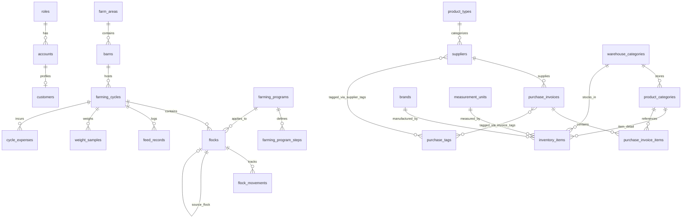

# Tài liệu Đặc tả Cơ sở Dữ liệu (Database Schema) - FarmShift

Tài liệu này mô tả chi tiết và toàn diện cấu trúc cơ sở dữ liệu của dự án FarmShift, bao gồm kiểu dữ liệu, ràng buộc (constraints), khóa ngoại (foreign keys), quy tắc nghiệp vụ (business rules) và đặc tả API liên quan.

Quy ước:
- Mỗi thay đổi về bảng, cột hoặc ràng buộc phải được cập nhật đồng bộ trong tài liệu này.
- File dữ liệu mẫu tương ứng là [insert_data.txt](file:///d:/Smart-Farm-Management-System/insert_data.txt), sử dụng cú pháp `ON CONFLICT DO NOTHING` hoặc `ON CONFLICT DO UPDATE` để đảm bảo tính lũy kế (idempotent), an toàn khi thực thi nhiều lần.
- Backend sử dụng Spring Data JPA / Hibernate (`spring.jpa.hibernate.ddl-auto=update`), tự động kiểm tra và cập nhật cấu trúc bảng khi khởi động.

---

## Sơ đồ Thực thể Quan hệ (Entity-Relationship Diagram)

---

## PHẦN 1: QUẢN TRỊ NGƯỜI DÙNG & XÁC THỰC

### 1.1 Bảng `roles` — Vai trò người dùng

Entity: `Role`. Quản lý các vai trò / phân quyền truy cập trong toàn bộ hệ thống FarmShift.

| Trường | Kiểu dữ liệu | Ràng buộc / Ý nghĩa |
| :--- | :--- | :--- |
| `id` | BIGSERIAL | PRIMARY KEY, tự tăng. |
| `name` | VARCHAR(30) | NOT NULL, UNIQUE. Tên định danh vai trò: `ROLE_FARM_OWNER` (Chủ trại), `ROLE_ACCOUNTANT` (Kế toán), `ROLE_FARM_WORKER` (Công nhân). |
| `description` | VARCHAR(200) | Mô tả chi tiết quyền hạn của vai trò. |

### 1.2 Bảng `accounts` — Tài khoản người dùng

Entity: `Account`. Quản lý thông tin xác thực, đăng nhập và trạng thái hoạt động.

| Trường | Kiểu dữ liệu | Ràng buộc / Ý nghĩa |
| :--- | :--- | :--- |
| `id` | BIGSERIAL | PRIMARY KEY, tự tăng. |
| `email` | VARCHAR(50) | NOT NULL, UNIQUE. Email định danh dùng để đăng nhập. |
| `password` | VARCHAR(255) | NOT NULL. Mật khẩu đã được mã hóa bằng BCrypt (`$2a$10$...`). |
| `role_id` | BIGINT | FOREIGN KEY → `roles.id`. Xác định vai trò của tài khoản. EAGER fetch. |
| `full_name` | VARCHAR(100) | Họ và tên hiển thị của tài khoản. |
| `avatar_url` | TEXT | Đường dẫn URL ảnh đại diện cá nhân (local `/img/avatars/...` hoặc Cloudflare R2). |
| `is_active` | BOOLEAN | DEFAULT TRUE. Trạng thái hoạt động (`TRUE`: cho phép đăng nhập, `FALSE`: khóa). |
| `created_at` | TIMESTAMP | Thời điểm tạo tài khoản. |

### 1.3 Bảng `customers` — Hồ sơ người dùng / nhân sự

Entity: `Customer`. Lưu trữ chi tiết thông tin nhân thân gắn liền với tài khoản (quan hệ 1-1).

| Trường | Kiểu dữ liệu | Ràng buộc / Ý nghĩa |
| :--- | :--- | :--- |
| `id` | BIGSERIAL | PRIMARY KEY, tự tăng. |
| `account_id` | BIGINT | UNIQUE, FOREIGN KEY → `accounts.id` ON DELETE CASCADE. |
| `full_name` | VARCHAR(100) | NOT NULL. Họ tên người dùng / nhân sự. |
| `phone` | VARCHAR(20) | Số điện thoại liên lạc. |
| `citizen_id` | VARCHAR(20) | UNIQUE. Số CMND / CCCD cá nhân. |
| `address` | VARCHAR(255) | Địa chỉ nơi cư trú. |
| `avatar_url` | TEXT | URL ảnh chân dung. Đồng bộ với `accounts.avatar_url`. |
| `date_of_birth` | DATE | Ngày tháng năm sinh. |
| `created_at` | TIMESTAMP | Thời điểm tạo hồ sơ. |

### 1.4 Bảng `otp_tokens` — Mã xác thực OTP đặt lại mật khẩu

Entity: `OtpToken`. Quản lý mã OTP 6 chữ số phục vụ luồng **Quên mật khẩu** (`/forgot-password` & `/reset-password`).

| Trường | Kiểu dữ liệu | Ràng buộc / Ý nghĩa |
| :--- | :--- | :--- |
| `id` | BIGSERIAL | PRIMARY KEY, tự tăng. |
| `email` | VARCHAR(100) | NOT NULL. Địa chỉ email nhận OTP (không ràng buộc FK để phòng thủ tấn công rà quét tài khoản). |
| `code` | VARCHAR(6) | NOT NULL. Mã xác thực gồm 6 chữ số ngẫu nhiên. |
| `expires_at` | TIMESTAMP | NOT NULL. Thời điểm hết hạn (mặc định 5 phút kể từ lúc sinh mã). |
| `is_used` | BOOLEAN | NOT NULL, DEFAULT FALSE. Đánh dấu `TRUE` ngay khi được sử dụng để đổi mật khẩu. |
| `created_at` | TIMESTAMP | Thời điểm phát hành OTP. |

**Quy tắc nghiệp vụ & API:**
- `POST /api/auth/forgot-password`: Nhận email, tạo OTP mới và gửi qua email. Luôn trả HTTP 200 (anti-enumeration).
- `POST /api/auth/verify-otp`: Kiểm tra mã OTP hợp lệ trước khi cho phép nhập mật khẩu mới.
- `POST /api/auth/reset-password`: Xác thực OTP, cập nhật mật khẩu mới đã mã hóa BCrypt cho tài khoản tương ứng, và đánh dấu `is_used = true`.

---

## PHẦN 2: THIẾT LẬP CHUNG & CƠ SỞ TRANG TRẠI

### 2.1 Bảng `farms` — Thông tin cơ sở & Trang trại

Entity: `Farm`. Lưu trữ hồ sơ định danh cơ sở chăn nuôi tại **Thiết lập chung → Thông tin cơ sở**.

| Trường | Kiểu dữ liệu | Ràng buộc / Ý nghĩa |
| :--- | :--- | :--- |
| `id` | BIGINT | PRIMARY KEY. ID cố định = `1` đại diện cho trang trại hiện hành. |
| `name` | VARCHAR(200) | NOT NULL. Tên trang trại / cơ sở kinh doanh; hiển thị tại header và báo cáo. |
| `owner` | VARCHAR(100) | NOT NULL. Chủ hộ / người đại diện pháp luật. |
| `phone` | VARCHAR(20) | NOT NULL. Số điện thoại đường dây nóng / liên hệ. |
| `scale` | VARCHAR(100) | Quy mô thiết kế chăn nuôi (VD: `50.000 con`). |
| `address` | VARCHAR(500) | Địa chỉ trụ sở / vị trí trang trại. |
| `type` | VARCHAR(200) | Mô hình sản xuất (VD: `Gà thịt thương phẩm hướng an toàn sinh học`). |
| `created_at` | TIMESTAMP | Thời điểm khởi tạo. |
| `updated_at` | TIMESTAMP | Thời điểm cập nhật lần cuối. |

**API:** `GET /api/farm` (tất cả tài khoản), `PUT /api/farm` (chỉ dành cho `ROLE_FARM_OWNER`).

---

## PHẦN 3: THIẾT LẬP DANH MỤC & ĐỐI TÁC

### 3.1 Bảng `customer_contacts` — Danh bạ khách hàng

Entity: `CustomerContact`. Phục vụ quản lý đối tác thương mại tại **Thiết lập danh mục → Khách hàng**.

| Trường | Kiểu dữ liệu | Ràng buộc / Ý nghĩa |
| :--- | :--- | :--- |
| `id` | BIGINT | PRIMARY KEY, tự tăng. |
| `code` | VARCHAR(40) | NOT NULL, UNIQUE. Mã định danh nghiệp vụ sinh tự động `KH` + UUID (không gạch nối). |
| `name` | VARCHAR(200) | NOT NULL. Tên khách hàng / đơn vị thu mua. |
| `phone` | VARCHAR(20) | NOT NULL. Số điện thoại (kiểm tra định dạng 10 số di động hoặc 11 số cố định). |
| `created_at` | TIMESTAMP | Thời điểm thêm vào danh bạ. |
| `updated_at` | TIMESTAMP | Thời điểm chỉnh sửa. |

**API:** `GET /api/customer-contacts?page=0&q=...` (phân trang 10 dòng/trang), `POST`, `PUT /{id}`, `DELETE /{id}` (`ROLE_FARM_OWNER`).

### 3.2 Bảng `product_types` — Loại hàng hóa

Entity: `ProductType`. Phục vụ nhóm phân loại tại **Thiết lập danh mục → Loại hàng hóa**.

| Trường | Kiểu dữ liệu | Ràng buộc / Ý nghĩa |
| :--- | :--- | :--- |
| `id` | BIGINT | PRIMARY KEY, tự tăng. |
| `code` | VARCHAR(50) | Mã loại sinh dạng `LH000001`. |
| `name` | VARCHAR(150) | NOT NULL. Tên nhóm hàng hóa (VD: `Thức ăn chăn nuôi`, `Con giống`, `Thuốc thú y`). |
| `name_key` | VARCHAR(150) | NOT NULL, UNIQUE. Tên chuẩn hóa NFC chữ thường ngăn trùng lặp. |
| `description` | VARCHAR(1000) | Mô tả chi tiết nhóm hàng. |
| `quantity` | INTEGER | NOT NULL, DEFAULT 0. Số lượng mặt hàng thuộc nhóm. |
| `created_at`, `updated_at` | TIMESTAMP | Thời điểm tạo và cập nhật. |

**API:** `GET /api/product-types`, `POST`, `PUT /{id}`, `DELETE /{id}` (`ROLE_FARM_OWNER`).

### 3.3 Bảng `suppliers` — Nhà cung cấp

Entity: `Supplier`. Quản lý đối tác cung ứng tại **Thiết lập danh mục → Nhà cung cấp** và liên kết chặt chẽ với phân hệ **Nhập hàng**.

| Trường | Kiểu dữ liệu | Ràng buộc / Ý nghĩa |
| :--- | :--- | :--- |
| `id` | BIGINT | PRIMARY KEY, tự tăng. |
| `code` | VARCHAR(40) | NOT NULL, UNIQUE. Mã định danh `NCC` + UUID, sinh tự động tại `@PrePersist`. |
| `name` | VARCHAR(200) | NOT NULL. Tên doanh nghiệp / đơn vị cung cấp. |
| `name_key` | VARCHAR(200) | NOT NULL, UNIQUE. Tên chuẩn hóa NFC chữ thường chống trùng. |
| `representative` | VARCHAR(100) | NOT NULL. Tên người liên hệ / đại diện bán hàng. |
| `phone` | VARCHAR(20) | NOT NULL. Số điện thoại liên hệ (chuẩn hóa 10-11 số). |
| `product_type_id` | BIGINT | NOT NULL, FOREIGN KEY → `product_types.id`. Nhóm hàng hóa chính cung cấp. |
| `email` | VARCHAR(100) | Hộp thư điện tử liên hệ. |
| `address` | VARCHAR(300) | Địa chỉ trụ sở / chi nhánh nhà cung cấp. |
| `tax_code` | VARCHAR(50) | Mã số thuế doanh nghiệp. |
| `bank_name` | VARCHAR(100) | Tên ngân hàng giao dịch (VD: `Vietcombank`, `BIDV`). |
| `bank_account` | VARCHAR(50) | Số tài khoản ngân hàng thụ hưởng. |
| `payment_policy` | VARCHAR(50) | Chính sách thanh toán (VD: `Trả theo đơn`, `Trả sau`, `Gối đầu 30 ngày`). |
| `opening_debt` | BIGINT | DEFAULT 0. Nợ đầu kỳ ghi nhận trước khi sử dụng hệ thống (VNĐ). |
| `note` | VARCHAR(1000) | Ghi chú thêm về năng lực, thỏa thuận cung ứng. |
| `created_at`, `updated_at` | TIMESTAMP | Thời điểm tạo và cập nhật. |

**Bảng liên kết N-N:** `supplier_tag_mappings` liên kết `supplier_id` (FK `suppliers`) và `tag_id` (FK `purchase_tags`).
**Thuộc tính tính toán trả về qua API:**
- `totalPurchased`: Tổng lũy kế giá trị các đơn nhập hàng từ nhà cung cấp này (loại trừ các đơn `Đã hủy`).
- `debt`: Tổng dư nợ hiện tại = `openingDebt` + (tổng `totalAmount` - tổng `paidAmount` của các đơn chưa trả hết).

**API:** `GET /api/suppliers`, `GET /api/suppliers/{id}` (mọi tài khoản đã login), `POST`, `PUT /{id}`, `DELETE /{id}` (`ROLE_FARM_OWNER`).

### 3.4 Bảng `warehouse_categories` — Danh mục kho

Entity: `WarehouseCategory`. Quản lý phân loại kho lưu trữ tại **Thiết lập danh mục → Danh mục kho**.

| Trường | Kiểu dữ liệu | Ràng buộc / Ý nghĩa |
| :--- | :--- | :--- |
| `id` | BIGINT | PRIMARY KEY, tự tăng. |
| `name` | VARCHAR(150) | NOT NULL. Tên kho lưu trữ (VD: `Kho cám`, `Kho thuốc & Vắc-xin`, `Kho vật tư`). |
| `name_key` | VARCHAR(150) | NOT NULL, UNIQUE. Tên chuẩn hóa ngăn trùng lặp. |
| `description` | VARCHAR(1000) | Mô tả công năng kho. |
| `created_at`, `updated_at` | TIMESTAMP | Thời điểm tạo và cập nhật. |

**Ràng buộc toàn vẹn:** Không thể xóa danh mục kho khi đang có hàng hóa thuộc danh mục (`product_categories`) hoặc tồn kho (`inventory_items`) tham chiếu tới.
**API:** `GET /api/warehouse-categories`, `POST`, `PUT /{id}`, `DELETE /{id}` (`ROLE_FARM_OWNER`).

### 3.5 Bảng `measurement_units` — Đơn vị tính

Entity: `MeasurementUnit`. Quản lý quy chuẩn đơn vị tại **Thiết lập danh mục → Đơn vị tính**.

| Trường | Kiểu dữ liệu | Ràng buộc / Ý nghĩa |
| :--- | :--- | :--- |
| `id` | BIGINT | PRIMARY KEY, tự tăng. |
| `code` | VARCHAR(30) | NOT NULL. Mã viết tắt đơn vị (VD: `BAO25`, `KG`, `LO1000`, `CAN5L`, `CON`). |
| `code_key` | VARCHAR(30) | NOT NULL, UNIQUE. Mã chuẩn hóa chữ thường. |
| `name` | VARCHAR(150) | NOT NULL. Tên hiển thị đơn vị (VD: `Bao (25kg)`, `Kg`, `Lọ 1000 liều`). |
| `name_key` | VARCHAR(150) | NOT NULL, UNIQUE. Tên chuẩn hóa chữ thường. |
| `description` | VARCHAR(1000) | Mô tả chi tiết đơn vị. |
| `content_quantity` | NUMERIC(14,3) | Quy cách: 1 đơn vị này chứa bao nhiêu (VD: `25` với `Bao (25kg)`). NULL nếu không quy đổi. Phải nhập cùng `content_unit`. |
| `content_unit` | VARCHAR(10) | Đơn vị của quy cách: `KG`, `G`, `L`, `ML`, `DOSE` (liều). Dùng để đổi định mức chương trình nuôi sang số bao / lọ / chai cần trừ kho. Không đổi được khi còn hàng hóa tồn kho dùng đơn vị này. |
| `created_at`, `updated_at` | TIMESTAMP | Thời điểm tạo và cập nhật. |

**API:** `GET /api/measurement-units`, `POST`, `PUT /{id}`, `DELETE /{id}` (`ROLE_FARM_OWNER`).

### 3.6 Bảng `brands` — Nhãn hiệu

Entity: `Brand`. Quản lý thương hiệu đối tác tại **Thiết lập danh mục → Nhãn hiệu**.

| Trường | Kiểu dữ liệu | Ràng buộc / Ý nghĩa |
| :--- | :--- | :--- |
| `id` | BIGINT | PRIMARY KEY, tự tăng. |
| `name` | VARCHAR(150) | NOT NULL. Tên thương hiệu (VD: `C.P. Việt Nam`, `Tập đoàn Dabaco`, `Hanvet`). |
| `name_key` | VARCHAR(150) | NOT NULL, UNIQUE. Tên chuẩn hóa chống trùng lặp. |
| `product_type` | VARCHAR(150) | Lĩnh vực chuyên môn của thương hiệu. |
| `quantity` | INTEGER | NOT NULL, DEFAULT 0. Số lượng sản phẩm gắn với thương hiệu. |
| `note` | VARCHAR(1000) | Ghi chú về nhà sản xuất. |
| `created_at`, `updated_at` | TIMESTAMP | Thời điểm tạo và cập nhật. |

**API:** `GET /api/brands`, `POST`, `PUT /{id}`, `DELETE /{id}` (`ROLE_FARM_OWNER`).

### 3.7 Bảng `specifications` — Đơn vị quy cách

Entity: `Specification`. Quản lý quy cách đóng gói tại **Thiết lập danh mục → Đơn vị quy cách**.

| Trường | Kiểu dữ liệu | Ràng buộc / Ý nghĩa |
| :--- | :--- | :--- |
| `id` | BIGINT | PRIMARY KEY, tự tăng. |
| `name` | VARCHAR(150) | NOT NULL. Tên quy cách (VD: `Bao 25kg`, `Chai 1L`, `Lọ 1000 liều`). |
| `name_key` | VARCHAR(150) | NOT NULL, UNIQUE. Tên chuẩn hóa chống trùng. |
| `unit` | VARCHAR(150) | Đơn vị tính cơ sở (Bao, Thùng, Chai, Lọ, Gói). |
| `items` | VARCHAR(150) | Giá trị định mức quy đổi (25 kg, 1000 liều, 1 lít). |
| `note` | VARCHAR(1000) | Ghi chú quy cách. |
| `created_at`, `updated_at` | TIMESTAMP | Thời điểm tạo và cập nhật. |

**API:** `GET /api/specifications`, `POST`, `PUT /{id}`, `DELETE /{id}` (`ROLE_FARM_OWNER`).

### 3.8 Bảng `product_categories` — Tên hàng hóa

Entity: `ProductCategory`. Quản lý danh mục hàng hóa tại **Thiết lập danh mục → Tên hàng hóa**.

| Trường | Kiểu dữ liệu | Ràng buộc / Ý nghĩa |
| :--- | :--- | :--- |
| `id` | BIGINT | PRIMARY KEY, tự tăng. |
| `name` | VARCHAR(150) | NOT NULL. Tên sản phẩm / hàng hóa. |
| `name_key` | VARCHAR(150) | NOT NULL, UNIQUE. Tên chuẩn hóa NFC chữ thường ngăn trùng. |
| `description` | VARCHAR(1000) | Mô tả chi tiết tính năng, thành phần. |
| `specification` | VARCHAR(150) | Quy cách đóng gói (tham chiếu văn bản từ Specifications). |
| `brand` | VARCHAR(150) | Thương hiệu sản xuất (tham chiếu văn bản từ Brands). |
| `product_type` | VARCHAR(150) | Phân loại hàng hóa. |
| `warehouse_id` | BIGINT | FOREIGN KEY → `warehouse_categories.id`. Kho lưu trữ mặc định. |
| `created_at`, `updated_at` | TIMESTAMP | Thời điểm tạo và cập nhật. |

**API:** `GET /api/product-categories`, `POST`, `PUT /{id}`, `DELETE /{id}` (`ROLE_FARM_OWNER`).

---

## PHẦN 4: QUẢN LÝ KHO & TỒN KHO CHI TIẾT

### 4.1 Bảng `inventory_items` — Mặt hàng tồn kho / Chi tiết tồn kho

Entity: `InventoryItem`. Quản lý tồn kho thực tế, đơn giá bán/xuất và mã vạch sản phẩm theo từng kho vật lý.

| Trường | Kiểu dữ liệu | Ràng buộc / Ý nghĩa |
| :--- | :--- | :--- |
| `id` | BIGINT | PRIMARY KEY, tự tăng. |
| `code` | VARCHAR(40) | NOT NULL, UNIQUE. Mã sản phẩm sinh tự động dạng `SP` + UUID chữ in hoa (không đổi khi sửa). |
| `warehouse_id` | BIGINT | NOT NULL, FOREIGN KEY → `warehouse_categories.id`. Kho lưu trữ mặt hàng. |
| `product_id` | BIGINT | NOT NULL, FOREIGN KEY → `product_categories.id`. Loại hàng hóa trong danh mục. |
| `brand_id` | BIGINT | FOREIGN KEY → `brands.id`. Nhãn hiệu sản phẩm (có thể để trống). |
| `unit_id` | BIGINT | FOREIGN KEY → `measurement_units.id` (`fk_inventory_unit`). Đơn vị tính định lượng. |
| `price` | NUMERIC(19,2) | NOT NULL. Đơn giá vốn hoặc giá niêm yết hiện hành của mặt hàng (VNĐ). |
| `stock` | NUMERIC(19,3) | NOT NULL, DEFAULT 0.000. Số lượng tồn kho thực tế hiện có trong kho. |
| `image_url` | TEXT | Đường dẫn URL hình ảnh mặt hàng. |
| `created_at`, `updated_at` | TIMESTAMP | Thời điểm tạo và cập nhật. |

**Ràng buộc duy nhất:**
- `uq_inventory_warehouse_product`: UNIQUE (`warehouse_id`, `product_id`). Trong cùng một kho, mỗi loại mặt hàng chỉ tồn tại duy nhất một dòng quản lý tồn kho.

**Quy tắc nghiệp vụ & Tương tác:**
1. Khi xác nhận nhập kho hóa đơn mua hàng (`POST /api/purchases/{id}/import-stock` hoặc tạo đơn với `stock_status = 'Đã nhập kho'`), hệ thống tìm bản ghi trong kho tương ứng. Nếu đã có thì cộng lũy kế `stock += item.quantity`, nếu chưa có sẽ tự động khởi tạo mặt hàng tồn kho mới.
2. Khi hủy đơn nhập hàng (`POST /api/purchases/{id}/cancel`), lượng tồn kho tương ứng sẽ tự động được khấu trừ hoàn lại để bảo đảm số liệu sổ sách.

**API:**
- `GET /api/inventory-items?warehouseId={id}`: Danh sách toàn bộ mặt hàng thuộc một kho lưu trữ.
- `GET /api/inventory-items/{id}`: Chi tiết một mặt hàng tồn kho.
- `POST /api/inventory-items`: Thêm mặt hàng mới vào kho (`ROLE_FARM_OWNER`).
- `PUT /api/inventory-items/{id}`: Điều chỉnh đơn giá, đơn vị tính hoặc nhãn hiệu (`ROLE_FARM_OWNER`).
- `DELETE /api/inventory-items/{id}`: Xóa bản ghi mặt hàng (`ROLE_FARM_OWNER`).

---

## PHẦN 5: QUẢN LÝ NHẬP HÀNG & HÓA ĐƠN MUA

### 5.1 Bảng `purchase_tags` — Thẻ phân loại mua hàng

Entity: `PurchaseTag`. Phục vụ gắn nhãn phân loại, đánh dấu nguồn gốc cho cả Nhà cung cấp và Hóa đơn nhập hàng.

| Trường | Kiểu dữ liệu | Ràng buộc / Ý nghĩa |
| :--- | :--- | :--- |
| `id` | BIGINT | PRIMARY KEY, tự tăng. |
| `name` | VARCHAR(100) | NOT NULL. Tên nhãn hiển thị (VD: `Cám giai đoạn 1 (Úm)`, `Gà giống đợt tháng 9`). |
| `name_key` | VARCHAR(100) | NOT NULL, UNIQUE. Tên chuẩn hóa NFC chữ thường ngăn trùng. |
| `color` | VARCHAR(30) | NOT NULL. Mã màu HEX hiển thị huy hiệu (VD: `#019788`, `#aa2d00`). |
| `description` | VARCHAR(500) | Mô tả mục đích sử dụng của thẻ. |
| `created_at`, `updated_at` | TIMESTAMP | Thời điểm tạo và cập nhật. |

**API:** `GET /api/purchase-tags`, `POST`, `PUT /{id}`, `DELETE /{id}` (`ROLE_FARM_OWNER`).

### 5.2 Bảng `purchase_invoices` — Hóa đơn nhập hàng

Entity: `PurchaseInvoice`. Quản lý các chứng từ mua vật tư, cám, vắc-xin, con giống tại **Nhập hàng** (`/purchases`).

| Trường | Kiểu dữ liệu | Ràng buộc / Ý nghĩa |
| :--- | :--- | :--- |
| `id` | BIGINT | PRIMARY KEY, tự tăng. |
| `code` | VARCHAR(30) | NOT NULL, UNIQUE. Mã chứng từ nhập hàng, ví dụ: `NH000001`. |
| `supplier_id` | BIGINT | NOT NULL, FOREIGN KEY → `suppliers.id` (`fk_purchase_supplier`). Nhà cung cấp. |
| `invoice_date` | DATE | NOT NULL. Ngày ghi nhận chứng từ / giao hàng. |
| `discount_amount` | BIGINT | DEFAULT 0. Giá trị chiết khấu / giảm giá trên đơn hàng (VNĐ). |
| `other_cost` | BIGINT | DEFAULT 0. Chi phí vận chuyển / bốc xếp phát sinh (VNĐ). |
| `total_amount` | BIGINT | NOT NULL, DEFAULT 0. Tổng số tiền phải thanh toán của đơn hàng (sau thuế, chiết khấu). |
| `paid_amount` | BIGINT | NOT NULL, DEFAULT 0. Số tiền đã thanh toán cho nhà cung cấp (VNĐ). |
| `payment_status` | VARCHAR(50) | NOT NULL. `Thanh toán hoàn tất`, `Trả sau`, `Thanh toán một phần`, `Đã hủy`. |
| `stock_status` | VARCHAR(50) | NOT NULL. `Đã nhập kho`, `Chưa nhập kho`. |
| `reference_code` | VARCHAR(100) | Số hóa đơn VAT / mã chứng từ gốc của bên bán (VD: `HD-CP-0915`). |
| `note` | VARCHAR(1000) | Ghi chú chi tiết về đợt nhập hàng. |
| `attachment_url` | VARCHAR(500) | Đường dẫn ảnh chụp hóa đơn chứng từ gốc (phục vụ đối soát). |
| `created_at`, `updated_at` | TIMESTAMP | Thời điểm tạo và cập nhật. |

**Bảng liên kết N-N:** `purchase_invoice_tag_mappings` liên kết `invoice_id` (FK `purchase_invoices`) và `tag_id` (FK `purchase_tags`).

### 5.3 Bảng `purchase_invoice_items` — Chi tiết mặt hàng hóa đơn nhập

Entity: `PurchaseInvoiceItem`. Danh sách từng mặt hàng cụ thể trong đơn nhập hàng (One-to-Many từ `purchase_invoices`).

| Trường | Kiểu dữ liệu | Ràng buộc / Ý nghĩa |
| :--- | :--- | :--- |
| `id` | BIGINT | PRIMARY KEY, tự tăng. |
| `invoice_id` | BIGINT | NOT NULL, FOREIGN KEY → `purchase_invoices.id` ON DELETE CASCADE. |
| `product_category_id` | BIGINT | FOREIGN KEY → `product_categories.id` (nullable để hỗ trợ nhập tự do). |
| `product_name` | VARCHAR(200) | NOT NULL. Tên mặt hàng hiển thị trên hóa đơn. |
| `quantity` | DOUBLE PRECISION | NOT NULL, DEFAULT 1.0. Số lượng nhập. |
| `unit` | VARCHAR(50) | NOT NULL. Đơn vị tính (VD: `Bao (25kg)`, `Kg`, `Con`, `Lọ 1000 liều`). |
| `unit_price` | BIGINT | NOT NULL, DEFAULT 0. Đơn giá nhập trước VAT (VNĐ). |
| `vat_rate` | DOUBLE PRECISION | DEFAULT 0.0. Thuế suất VAT (0%, 5%, 8%, 10%). |
| `amount` | BIGINT | NOT NULL, DEFAULT 0. Thành tiền mặt hàng = `round(quantity * unit_price * (1 + vat_rate / 100))`. |

**API Quản lý Nhập hàng:**
- `GET /api/purchases?search=...&paymentStatus=...`: Tìm kiếm, lọc hóa đơn nhập hàng.
- `GET /api/purchases/{id}`: Xem chi tiết hóa đơn kèm danh sách mặt hàng và thẻ tags.
- `POST /api/purchases`: Tạo mới hóa đơn. Tự động tăng tồn kho nếu chọn `stock_status = 'Đã nhập kho'` (`ROLE_FARM_OWNER`, `ROLE_ACCOUNTANT`).
- `POST /api/purchases/{id}/import-stock`: Xác nhận nhập kho cho các đơn tạo trước ở trạng thái 'Chưa nhập kho' (`ROLE_FARM_OWNER`, `ROLE_ACCOUNTANT`, `ROLE_FARM_WORKER`).
- `POST /api/purchases/{id}/pay`: Ghi nhận thanh toán bổ sung cho hóa đơn trả sau (`ROLE_FARM_OWNER`, `ROLE_ACCOUNTANT`).
- `POST /api/purchases/{id}/cancel` (hoặc `DELETE /{id}`): Hủy đơn nhập hàng, tự động hoàn trả tồn kho nếu đã nhập trước đó (`ROLE_FARM_OWNER`, `ROLE_ACCOUNTANT`).
- `POST /api/purchases/ocr`: Bóc tách thông minh chứng từ hóa đơn từ file ảnh chụp hoặc camera stream (`ROLE_FARM_OWNER`, `ROLE_ACCOUNTANT`).

---

## PHẦN 6: CHĂN NUÔI & QUẢN LÝ CHUỒNG TRẠI

### 6.1 Bảng `farm_areas` — Khu nuôi

Entity: `FarmArea`. Quản lý các phân khu nuôi tại **Khu nuôi** (`/areas`).

| Trường | Kiểu dữ liệu | Ràng buộc / Ý nghĩa |
| :--- | :--- | :--- |
| `id` | BIGINT | PRIMARY KEY, tự tăng. |
| `name` | VARCHAR(150) | NOT NULL. Tên phân khu (VD: `Khu Mía Thịt`, `Khu J Thịt`). |
| `name_key` | VARCHAR(150) | NOT NULL, UNIQUE. Tên chuẩn hóa NFC chữ thường chống trùng. |
| `environment_metrics` | VARCHAR(200) | Danh sách chỉ số môi trường theo dõi: `HUMIDITY`, `TEMPERATURE`. |
| `animal_metrics` | VARCHAR(200) | Chỉ số vật nuôi theo dõi: `WEIGHT`, `LOSS`, `MANURE`, `ANIMAL_PHOTO`, `DEAD_PHOTO`, `NOTE`. |
| `description` | VARCHAR(1000) | Mô tả vị trí, địa hình khu nuôi. |
| `created_at`, `updated_at` | TIMESTAMP | Thời điểm tạo và cập nhật. |

**Quy tắc:** Không thể xóa khu nuôi khi đang có chuồng nuôi trực thuộc (409 `FARM_AREA_HAS_BARNS`).

### 6.2 Bảng `barns` — Chuồng nuôi

Entity: `Barn`. Quản lý chuồng trại cụ thể trong từng phân khu.

| Trường | Kiểu dữ liệu | Ràng buộc / Ý nghĩa |
| :--- | :--- | :--- |
| `id` | BIGINT | PRIMARY KEY, tự tăng. |
| `area_id` | BIGINT | NOT NULL, FOREIGN KEY → `farm_areas.id`. Phân khu sở tại. |
| `name` | VARCHAR(100) | NOT NULL. Tên chuồng (VD: `Nhà A1`, `Nhà B2`). |
| `name_key` | VARCHAR(100) | NOT NULL. Tên chuẩn hóa; UNIQUE cùng `area_id` qua `uk_barns_area_name`. |
| `status` | VARCHAR(20) | NOT NULL. `INACTIVE` (Chưa hoạt động) hoặc `ACTIVE` (Đang có lứa nuôi hoạt động). Hệ thống tự quản lý. |
| `capacity` | INT | NOT NULL. Sức chứa thiết kế tối đa (số con). |
| `current_quantity` | INT | NOT NULL, DEFAULT 0. Tổng số con hiện đang nuôi trong chuồng (tính từ các đàn thuộc lứa ACTIVE). |
| `area_m2` | NUMERIC(10,2) | Diện tích thực tế của chuồng (m²). Dùng để tính mật độ nuôi (con/m²). |
| `target_weight` | NUMERIC(5,2) | Trọng lượng mục tiêu xuất chuồng bình quân (kg/con). |
| `description` | VARCHAR(1000) | Mô tả quy cách chuồng, trang thiết bị giàn mát/quạt hút. |
| `created_at`, `updated_at` | TIMESTAMP | Thời điểm tạo và cập nhật. |

**Quy tắc:** Khi tạo chuồng gợi ý mật độ 8 con/m²; không chuyển khu khi chuồng đang có lứa nuôi; không xóa chuồng khi đang có vật nuôi hoặc có lịch sử lứa nuôi.

### 6.3 Bảng `farming_cycles` — Lứa nuôi

Entity: `FarmingCycle`. Quản lý từng chu kỳ sản xuất khép kín từ khi nhập gà con đến khi xuất bán hết.

| Trường | Kiểu dữ liệu | Ràng buộc / Ý nghĩa |
| :--- | :--- | :--- |
| `id` | BIGINT | PRIMARY KEY, tự tăng. |
| `barn_id` | BIGINT | NOT NULL, FOREIGN KEY → `barns.id`. Chuồng nuôi diễn ra lứa. |
| `cycle_number` | INT | NOT NULL. Số thứ tự lứa của chuồng (1, 2, 3...); UNIQUE cùng `barn_id` qua `uk_cycles_barn_number`. |
| `start_date` | DATE | NOT NULL. Ngày bắt đầu lứa nuôi. |
| `hatch_date` | DATE | Ngày nở của gà con giống (ngày tuổi 1). |
| `end_date` | DATE | Ngày xuất chuồng kết thúc lứa. |
| `status` | VARCHAR(20) | NOT NULL. `ACTIVE` (Đang nuôi) hoặc `CLOSED` (Đã hoàn thành/kết thúc). |
| `note` | VARCHAR(1000) | Ghi chú về diễn biến lứa nuôi. |
| `created_at`, `updated_at` | TIMESTAMP | Thời điểm tạo và cập nhật. |

**Quy tắc:** Mỗi chuồng chỉ có duy nhất 1 lứa ở trạng thái `ACTIVE` tại một thời điểm. Chỉ được kết thúc lứa khi tồn đàn đã về 0.

### 6.4 Bảng `flocks` — Đàn vật nuôi

Entity: `Flock`. Quản lý từng lô giống nhập hoặc chuyển vào trong một lứa nuôi.

| Trường | Kiểu dữ liệu | Ràng buộc / Ý nghĩa |
| :--- | :--- | :--- |
| `id` | BIGINT | PRIMARY KEY, tự tăng. |
| `cycle_id` | BIGINT | NOT NULL, FOREIGN KEY → `farming_cycles.id`. Lứa nuôi trực thuộc. |
| `name` | VARCHAR(150) | NOT NULL. Tên đàn (VD: `MÍA-DABACO TRỐNG`, `J-DABACO XÔ`). |
| `gender` | VARCHAR(20) | NOT NULL. `MALE` (Trống), `FEMALE` (Mái), `MIXED` (Xô). |
| `source_type` | VARCHAR(20) | NOT NULL. `PURCHASE` (Nhập con giống) hoặc `TRANSFER` (Tách/chuyển đàn từ chuồng khác). |
| `source_note` | VARCHAR(200) | Nơi cung ứng giống hoặc mã chuồng nguồn. |
| `source_flock_id` | BIGINT | FOREIGN KEY → `flocks.id`. Đàn gốc đối ứng khi tách/chuyển. |
| `program_id` | BIGINT | FOREIGN KEY → `farming_programs.id`. Chương trình nuôi kỹ thuật áp dụng theo giống. |
| `import_date` | DATE | NOT NULL. Ngày nhập hoặc ngày tiếp nhận đàn. |
| `age_at_import` | INT | NOT NULL. Ngày tuổi lúc nhập đàn. |
| `import_quantity` | INT | NOT NULL. Số lượng con nhập ban đầu. |
| `import_avg_weight` | NUMERIC(8,3) | NOT NULL. Trọng lượng bình quân lúc nhập (kg/con). |
| `unit_price` | NUMERIC(14,2) | NOT NULL. Giá vốn giống (VNĐ/con). Ẩn với công nhân. |
| `quantity` | INT | NOT NULL. Số lượng con hiện còn sống và đang nuôi trong đàn. |
| `status` | VARCHAR(20) | NOT NULL. `ACTIVE` (đang nuôi) hoặc `ARCHIVED` (tồn = 0, lưu trữ). |
| `note` | VARCHAR(1000) | Ghi chú đặc tính đàn. |
| `created_at`, `updated_at` | TIMESTAMP | Thời điểm tạo và cập nhật. |

**Quy tắc cửa sổ nhập đàn:** Các đàn nhập của cùng một lứa cách nhau không quá 3 ngày (`FLOCK_IMPORT_WINDOW`).

### 6.5 Bảng `flock_movements` — Biến động đàn

Entity: `FlockMovement`. Nhật ký bất biến ghi nhận mọi biến động số lượng gia cầm (nhập, chết, loại, bán, chuyển).

| Trường | Kiểu dữ liệu | Ràng buộc / Ý nghĩa |
| :--- | :--- | :--- |
| `id` | BIGINT | PRIMARY KEY, tự tăng. |
| `flock_id` | BIGINT | NOT NULL, FOREIGN KEY → `flocks.id`. Đàn chịu biến động. |
| `type` | VARCHAR(20) | NOT NULL. `IMPORT`, `TRANSFER_IN`, `TRANSFER_OUT`, `DEATH` (chết hao hụt), `CULL` (loại thải), `HARVEST` (xuất bán). |
| `movement_date` | DATE | NOT NULL. Ngày ghi nhận sự kiện. |
| `quantity` | INT | NOT NULL. Số con biến động (luôn ≥ 1). |
| `weight_kg` | NUMERIC(14,3) | Tổng khối lượng tương ứng (kg). Bắt buộc khi xuất bán. |
| `unit_price` | NUMERIC(14,2) | Đơn giá xuất bán (VNĐ/kg). |
| `related_flock_id` | BIGINT | FOREIGN KEY → `flocks.id`. Đàn đối ứng trong giao dịch chuyển đàn. |
| `note` | VARCHAR(1000) | Nguyên nhân biến động / chẩn đoán bệnh. |
| `created_by` | VARCHAR(150) | Email của người ghi nhận nhật ký. |
| `created_at` | TIMESTAMP | Thời điểm ghi hệ thống. |

### 6.6 Bảng `feed_records` — Nhật ký tiêu thụ cám

Entity: `FeedRecord`. Nhật ký ghi nhận lượng cám cho ăn hằng ngày của từng lứa để tính toán FCR.

| Trường | Kiểu dữ liệu | Ràng buộc / Ý nghĩa |
| :--- | :--- | :--- |
| `id` | BIGINT | PRIMARY KEY, tự tăng. |
| `cycle_id` | BIGINT | NOT NULL, FOREIGN KEY → `farming_cycles.id`. |
| `record_date` | DATE | NOT NULL. Ngày cấp thức ăn. |
| `feed_name` | VARCHAR(150) | NOT NULL. Tên loại cám (VD: `Higro 01`, `Higro 02`). |
| `quantity_kg` | NUMERIC(14,3) | NOT NULL. Khối lượng cám cho ăn (kg). |
| `unit_price` | NUMERIC(14,2) | Đơn giá cám (VNĐ/kg) để tính chi phí hạch toán. |
| `note` | VARCHAR(1000) | Ghi chú. |
| `created_by` | VARCHAR(150) | Tài khoản / Email người ghi nhận. |
| `created_at` | TIMESTAMP | Thời điểm tạo bản ghi hệ thống. |

### 6.7 Bảng `weight_samples` — Thông số cân mẫu vật nuôi

Entity: `WeightSample`. Lưu trữ kết quả cân mẫu định kỳ để theo dõi biểu đồ tăng trọng.

| Trường | Kiểu dữ liệu | Ràng buộc / Ý nghĩa |
| :--- | :--- | :--- |
| `id` | BIGINT | PRIMARY KEY, tự tăng. |
| `cycle_id` | BIGINT | NOT NULL, FOREIGN KEY → `farming_cycles.id`. |
| `sample_date` | DATE | NOT NULL. Ngày tiến hành cân mẫu. |
| `avg_weight_kg` | NUMERIC(8,3) | NOT NULL. Trọng lượng trung bình mẫu cân (kg/con). |
| `sample_size` | INT | Số lượng con lấy mẫu cân (VD: 50 con, 100 con). |
| `note` | VARCHAR(1000) | Ghi chú thể trạng, đồng đều. |
| `created_by` | VARCHAR(150) | Tài khoản / Email người ghi nhận cân mẫu. |
| `created_at` | TIMESTAMP | Thời điểm tạo bản ghi hệ thống. |

### 6.8 Bảng `cycle_expenses` — Khoản chi bổ sung lứa nuôi

Entity: `CycleExpense`. Lưu trữ các khoản chi trực tiếp phát sinh trong lứa nuôi phục vụ tính lãi lỗ P&L.

| Trường | Kiểu dữ liệu | Ràng buộc / Ý nghĩa |
| :--- | :--- | :--- |
| `id` | BIGINT | PRIMARY KEY, tự tăng. |
| `cycle_id` | BIGINT | NOT NULL, FOREIGN KEY → `farming_cycles.id`. |
| `expense_date` | DATE | NOT NULL. Ngày phát sinh chi phí. |
| `category` | VARCHAR(20) | NOT NULL. `ELECTRICITY` (điện), `WATER` (nước), `LABOR` (nhân công), `MEDICINE` (thuốc), `OTHER` (chi phí khác). |
| `amount` | NUMERIC(16,2) | NOT NULL. Số tiền chi trả (VNĐ). |
| `note` | VARCHAR(1000) | Diễn giải nội dung khoản chi. |
| `created_by` | VARCHAR(150) | Tài khoản / Email người hạch toán chi phí. |
| `created_at` | TIMESTAMP | Thời điểm tạo bản ghi hệ thống. |

### 6.9 Bảng `farming_programs` & `farming_program_steps` — Chương trình nuôi theo giống

Entity: `FarmingProgram` & `FarmingProgramStep`. Quản lý quy trình chăm sóc chuẩn theo ngày tuổi tại **Thiết lập chăn nuôi → Chương trình nuôi**.

**Bảng `farming_programs`:**
| Trường | Kiểu dữ liệu | Ràng buộc / Ý nghĩa |
| :--- | :--- | :--- |
| `id` | BIGINT | PRIMARY KEY, tự tăng. Mã hiển thị `CT0001`. |
| `name` | VARCHAR(150) | NOT NULL. Tên quy trình (VD: `Gà ta thả vườn`, `Gà Mía thương phẩm`). |
| `name_key` | VARCHAR(150) | NOT NULL, UNIQUE. Tên chuẩn hóa chống trùng. |
| `breed` | VARCHAR(100) | NOT NULL. Giống gà áp dụng. |
| `duration_days` | INT | NOT NULL. Chu kỳ nuôi dự kiến (ngày). |
| `target_weight_min`, `max` | NUMERIC(5,2) | Trọng lượng xuất chuồng mục tiêu (kg/con). |
| `description` | VARCHAR(1000) | Mô tả quy trình. |
| `created_at`, `updated_at` | TIMESTAMP | Thời điểm tạo và cập nhật. |

**Bảng `farming_program_steps`:**
| Trường | Kiểu dữ liệu | Ràng buộc / Ý nghĩa |
| :--- | :--- | :--- |
| `id` | BIGINT | PRIMARY KEY, tự tăng. |
| `program_id` | BIGINT | NOT NULL, FOREIGN KEY → `farming_programs.id` ON DELETE CASCADE. |
| `category` | VARCHAR(20) | NOT NULL. `FEED` (cám), `VACCINE` (vắc-xin), `MEDICINE` (thuốc), `TEMPERATURE` (nhiệt độ úm), `WORK` (công việc). |
| `name` | VARCHAR(200) | NOT NULL. Tên thuốc / vắc-xin / loại cám / công việc. |
| `day_from`, `day_to` | INT | NOT NULL. Giai đoạn ngày tuổi áp dụng (`day_from` ≤ `day_to`). |
| `quantity` | NUMERIC(14,3) | Định mức cám (g/con/ngày) hoặc liều dùng thuốc/vắc-xin. |
| `unit` | VARCHAR(50) | Đơn vị định mức (VD: `g/con/ngày`, `liều/con`, `ml/lít nước`). |
| `meals_per_day` | INT | Số cữ ăn trong ngày (đối với FEED). |
| `method` | VARCHAR(20) | Phương pháp: `EYE_NOSE` (nhỏ mắt mũi), `MOUTH` (uống), `DRINKING_WATER` (pha nước), `INJECTION` (tiêm), `WING_WEB` (chủng cánh), `MIX_FEED` (trộn cám), `MIX_WATER` (pha nước uống). |
| `temp_min`, `temp_max` | NUMERIC(4,1) | Nhiệt độ ngưỡng chuồng nuôi (°C) đối với `TEMPERATURE`. |
| `note` | VARCHAR(1000) | Hướng dẫn thực hiện chi tiết cho công nhân. |
| `inventory_item_id` | BIGINT | FOREIGN KEY → `inventory_items.id`, có thể NULL. Hàng hóa kho dùng cho bước cám / thuốc / vắc-xin để trừ kho và tính chi phí khi xác nhận phiếu việc. Hàng hóa phải có quy cách đơn vị cùng loại đại lượng với định mức (cám → khối lượng; thuốc, vắc-xin → tử số của đơn vị liều: `g/...`, `ml/...`, `liều/...`). Thuốc gắn hàng hóa phải ghi rõ liều theo `kg cám`, `lít nước` hoặc `con`. |

### 6.10 Bảng `daily_task_logs` — Phiếu việc hằng ngày đã xác nhận

Entity: `DailyTaskLog`. Màn **Việc hôm nay** (`/today-tasks`) và khối **Việc hôm nay** trong trang chuồng.

Phiếu việc không lưu sẵn mà được tính mỗi lần xem: **định mức 1 con của chương trình × số con còn lại của từng đàn cuối ngày đó** (đã trừ hao hụt, loại thải, xuất bán, chuyển đi sau ngày đó), gộp theo chuồng và theo hàng hóa (hoặc tên khi chưa gắn hàng hóa). Cám chia thành từng cữ; thuốc trộn cám tính theo kg cám của đàn trong ngày, thuốc pha nước theo lượng nước ước tính = 2 lít/kg cám; vắc-xin theo số con, làm tròn lên cả lọ. Bảng này chỉ lưu những việc đã được xác nhận.

| Trường | Kiểu dữ liệu | Ràng buộc / Ý nghĩa |
| :--- | :--- | :--- |
| `id` | BIGINT | PRIMARY KEY, tự tăng. |
| `cycle_id` | BIGINT | NOT NULL, FOREIGN KEY → `farming_cycles.id`. |
| `task_date` | DATE | NOT NULL. Ngày làm việc (từ ngày bắt đầu lứa đến hôm nay). |
| `task_key` | VARCHAR(120) | NOT NULL. Mã việc ổn định: `FEED:I{hàng hóa}:M{cữ}`, `VACCINE:I{hàng hóa}`, `MEDICINE:N{tên}`, `TEMPERATURE:N{tên}`, `WORK:N{tên}`. UNIQUE (`cycle_id`, `task_date`, `task_key`). |
| `category` | VARCHAR(20) | NOT NULL. `FEED`, `VACCINE`, `MEDICINE`, `TEMPERATURE`, `WORK`. |
| `task_name` | VARCHAR(200) | NOT NULL. Tên việc lúc xác nhận (giữ lịch sử khi chương trình bị sửa). |
| `meal` | INT | Cữ thứ mấy trong ngày (chỉ với cám). |
| `planned_quantity`, `actual_quantity` | NUMERIC(14,3) | Lượng theo kế hoạch và thực tế, cùng đơn vị `usage_unit`. |
| `usage_unit` | VARCHAR(10) | `KG` (cám), `G` / `ML` (thuốc), `DOSE` / `ML` (vắc-xin). |
| `inventory_item_id` | BIGINT | FOREIGN KEY → `inventory_items.id`. Hàng hóa đã trừ kho. |
| `stock_quantity` | NUMERIC(14,3) | Số đơn vị tồn kho đã trừ (bao, lọ, gói...). |
| `unit_price` | NUMERIC(19,2) | Giá một đơn vị tồn kho lúc xác nhận. |
| `cost` | NUMERIC(16,2) | Thành tiền = `stock_quantity` × `unit_price`. |
| `feed_record_id` | BIGINT | FOREIGN KEY → `feed_records.id`. Nhật ký cám sinh ra khi xác nhận cữ cám (đơn giá đ/kg = giá bao / kg mỗi bao). |
| `expense_id` | BIGINT | FOREIGN KEY → `cycle_expenses.id`. Khoản chi `MEDICINE` sinh ra khi xác nhận thuốc / vắc-xin có tiền. |
| `deviated` | BOOLEAN | NOT NULL. Lệch kế hoạch quá ngưỡng: cám ±10%, thuốc và vắc-xin ±1%. Khi lệch bắt buộc có `note`. |
| `note` | VARCHAR(1000) | Lý do / ghi chú của người làm. |
| `done_by` | VARCHAR(150) | NOT NULL. Email người xác nhận. |
| `done_at` | TIMESTAMP | NOT NULL. Thời điểm xác nhận. |

**Quy tắc:**
- Xác nhận cám / thuốc / vắc-xin có hàng hóa: trừ tồn kho bằng một câu `UPDATE ... WHERE stock >= lượng cần` (không thể âm kho khi hai người bấm cùng lúc); kho không đủ thì báo `STOCK_NOT_ENOUGH`.
- Hoàn tác: hoàn lại tồn kho, xóa nhật ký cám / khoản chi đã sinh. Chủ trại hoàn tác mọi việc; công nhân chỉ hoàn tác việc của mình trong hôm nay.
- Nhật ký cám / khoản chi sinh từ phiếu việc không xóa được ở nhật ký lứa (`RECORD_FROM_DAILY_PLAN`), phải hoàn tác ở phiếu việc.
- Hàng hóa đang gắn vào chương trình nuôi hoặc phiếu việc không xóa được (`INVENTORY_IN_USE`).

**API:** `GET /api/daily-plan?date=` (mọi chuồng đang nuôi), `GET /api/cycles/{id}/daily-plan?date=`, `POST /api/cycles/{id}/daily-plan/tasks` `{date, taskKey, actualQuantity?, note?}` và `DELETE /api/cycles/{id}/daily-plan/tasks?date=&taskKey=` (`ROLE_FARM_OWNER`, `ROLE_FARM_WORKER`). Tiền chỉ trả về cho chủ trại và kế toán.

---

## PHẦN 7: LƯU TRỮ VÀ QUẢN LÝ TỆP TIN (MEDIA & ATTACHMENTS)

Hệ thống hỗ trợ linh hoạt 2 chế độ lưu trữ qua biến môi trường `STORAGE_PROVIDER`:
1. `STORAGE_PROVIDER=local` (môi trường Dev / Local):
   - Ảnh đại diện được lưu vào thư mục: `frontendFarmShift/public/img/avatars/<UUID>.<ext>`.
   - Cơ sở dữ liệu lưu đường dẫn tương đối phục vụ web: `/img/avatars/<UUID>.<ext>`.
   - File đính kèm hóa đơn lưu vào thư mục `frontendFarmShift/public/uploads/...`.
2. `STORAGE_PROVIDER=r2` (môi trường Production / Cloud):
   - Tệp tin tải trực tiếp lên Cloudflare R2 bucket thông qua AWS S3 SDK.
   - Cơ sở dữ liệu lưu URL đầy đủ truy cập công khai CDN (VD: `https://pub-xxxx.r2.dev/avatars/<UUID>.png`).

`purchase_invoices.imported_date` (DATE, nullable): ngày nhập kho thực tế do server ghi theo Asia/Bangkok khi tạo hóa đơn ở trạng thái Đã nhập kho hoặc xác nhận nhập kho. Khác với ngày chứng từ `invoice_date`. Phiếu chưa nhập hoặc dữ liệu cũ chưa có ngày hiển thị —; không suy đoán ngày từ ngày chứng từ.

### Thông tin xuất hóa đơn bán hàng

- `customer_contacts.tax_code` (VARCHAR 50), `payment_method` (VARCHAR 100): mã số thuế và hình thức thanh toán, lưu từ form tạo đơn bán hàng.
- `sales_orders.customer_id`: FK tới `customer_contacts`, dùng đọc thông tin bên mua trên hóa đơn.
- `sales_orders.created_at`: thời điểm tạo đơn do server ghi theo Asia/Bangkok; mẫu hóa đơn hiển thị ngày của thời điểm này. Đơn cũ chưa có timestamp dùng `date` đã lưu, không tự đoán lại thời điểm tạo.
- API `GET /api/sales/orders/{id}/invoice`: chỉ trả các trường thông tin hóa đơn, không trả toàn bộ cấu hình hệ thống. Đơn cũ chưa liên kết khách hàng được tra bằng tên và số điện thoại.
- Thông tin đơn vị bán lấy từ `sales.invoice.seller.name`, `tax-code`, `address`, `phone`, `fax`, `bank-account` trong `application-local.properties`. Giá trị để trống chờ cấu hình thực tế. Không thêm bảng mới; khởi động backend với ddl-auto=update để bổ sung các cột.
