# Tài liệu Đặc tả Cơ sở Dữ liệu (Database Schema) - FarmShift

Tài liệu này mô tả chi tiết và toàn diện cấu trúc cơ sở dữ liệu của dự án FarmShift, bao gồm kiểu dữ liệu, ràng buộc (constraints), khóa ngoại (foreign keys), quy tắc nghiệp vụ (business rules) và đặc tả API liên quan.

Quy ước:
- Mỗi thay đổi về bảng, cột hoặc ràng buộc phải được cập nhật đồng bộ trong tài liệu này.
- File dữ liệu mẫu tương ứng là [docs/insert_data.txt](file:///d:/Smart-Farm-Management-System/docs/insert_data.txt) (sinh tự động bởi [scripts/generate_seed_data.py](file:///d:/Smart-Farm-Management-System/scripts/generate_seed_data.py) theo đặc tả [seed_data_spec.md](file:///d:/Smart-Farm-Management-System/.md/seed_data_spec.md)), thực hiện dọn bỏ các cột lịch sử không còn sử dụng (`DROP COLUMN IF EXISTS lot_number, expiry_date, min_stock`, `barns.target_weight`), làm sạch toàn bộ 48 bảng dữ liệu (`TRUNCATE TABLE ... RESTART IDENTITY CASCADE`) và nạp lại bộ dữ liệu mô phỏng liên tục **86 ngày** từ `01/09/2026` đến `25/11/2026` theo múi giờ `Asia/Bangkok` (an toàn khi chạy lại nhiều lần; yêu cầu cấu trúc bảng đã tồn tại).
- Backend cấu hình `spring.jpa.hibernate.ddl-auto=none` (`application.properties`) kết hợp **17 `ApplicationRunner`** tự động nâng cấp schema (`ADD COLUMN IF NOT EXISTS`, `DROP COLUMN IF EXISTS`, gỡ ràng buộc cũ, backfill khóa băm/công nợ) và khởi tạo dữ liệu gốc khi khởi động: `FarmJournalSchemaUpgrade`, `AreaWarehouseSchemaUpgrade`, `BarnResponsibilitySchemaUpgrade`, `DailyStockAllocationSchemaUpgrade`, `InventoryLotSchemaUpgrade`, `PurchasingDebtSchemaUpgrade`, `SalesOrderSchemaUpgrade`, `TransferCategorySchemaUpgrade`, `WarehouseWorkersSchemaUpgrade`, `BrandNameKeyUpgrade`, `SupplierNameKeyUpgrade`, `SalesInvoiceCodeMigration`, `InternalStockSeedRunner`, `PushSubscriptionSchemaUpgrade`, `AiInteractionLogSchemaUpgrade`, `FarmingProgramUpgradeSchemaRunner`, `DiseaseRecordSchemaUpgrade`.
- **Kiểm kê 51 bảng vật lý trong PostgreSQL:**
  - **44 JPA `@Entity`:** `roles`, `accounts`, `customers`, `otp_tokens`, `push_subscriptions`, `farms`, `customer_contacts`, `product_types`, `suppliers`, `warehouse_categories`, `measurement_units`, `brands`, `specifications`, `product_categories`, `inventory_items`, `internal_stock_categories`, `transfer_categories`, `internal_stock_vouchers`, `internal_stock_voucher_items`, `internal_stock_voucher_numbers`, `purchase_tags`, `purchase_invoices`, `purchase_invoice_items`, `purchase_payments`, `farm_areas`, `barns`, `barn_workers`, `farming_cycles`, `flocks`, `flock_movements`, `feed_records`, `weight_samples`, `cycle_expenses`, `cycle_carried_expenses`, `cycle_diseases`, `disease_treatment_logs`, `farming_programs`, `farming_program_steps`, `daily_task_logs`, `work_tasks`, `work_task_checks`, `sales_orders`, `sales_invoice_numbers`, `ai_interaction_logs`.
  - **2 `@Embeddable` (`@ElementCollection`):** `daily_stock_allocations` (thuộc `DailyTaskLog`), `disease_treatment_stock_allocations` (thuộc `DiseaseTreatmentLog`).
  - **5 bảng trung gian N-N (`@ManyToMany`):** `farm_area_workers`, `farm_area_warehouses`, `warehouse_workers`, `supplier_tag_mappings`, `purchase_invoice_tag_mappings`.
  - *Lưu ý:* Các `enum` Java (`BarnStatus`, `CycleStatus`, `DiseaseStatus`, `FlockGender`, `FlockMovementType`, `FlockSource`, `FlockStatus`, `ExpenseCategory`, `ProgramStepCategory`, `AdministrationMethod`, `UsageUnit`) được ánh xạ dạng `VARCHAR` trong bảng, không tạo Postgres `ENUM` type riêng. Dữ liệu IoT ESP32 và luồng Camera QR hoạt động ở RAM / `localStorage`, không tạo bảng PostgreSQL riêng.

---

## Sơ đồ Thực thể Quan hệ (Entity-Relationship Diagram)

```mermaid
erDiagram
    %% Auth & User
    roles ||--o{ accounts : "has"
    accounts ||--o| customers : "profiles"
    accounts ||--o{ push_subscriptions : "receives_push"
    accounts ||--o{ ai_interaction_logs : "logs_ai_turns"
    
    %% Farm Infrastructure & Daily Operations
    farm_areas ||--o{ barns : "contains"
    farm_areas }o--o{ warehouse_categories : "linked_via_farm_area_warehouses"
    farm_areas }o--o{ accounts : "assigned_via_farm_area_workers"
    warehouse_categories }o--o{ accounts : "assigned_via_warehouse_workers"
    barns ||--o{ farming_cycles : "hosts"
    farming_cycles ||--o{ flocks : "contains"
    flocks ||--o{ flock_movements : "tracks"
    farming_cycles ||--o{ feed_records : "logs"
    farming_cycles ||--o{ weight_samples : "weighs"
    farming_cycles ||--o{ cycle_expenses : "incurs"
    farming_cycles ||--o{ cycle_carried_expenses : "carries_expenses"
    farming_cycles ||--o{ cycle_diseases : "tracks_diseases"
    flocks ||--o{ cycle_diseases : "affected_flock"
    cycle_diseases ||--o{ disease_treatment_logs : "treated_with"
    disease_treatment_logs ||--o| cycle_expenses : "books_medicine_expense"
    disease_treatment_logs ||--o{ disease_treatment_stock_allocations : "allocates_fifo_stock"
    farming_cycles ||--o{ daily_task_logs : "confirms_tasks"
    daily_task_logs ||--o| feed_records : "creates_feed"
    daily_task_logs ||--o| cycle_expenses : "creates_expense"
    daily_task_logs ||--o{ daily_stock_allocations : "allocates_stock"
    farming_programs ||--o{ farming_program_steps : "defines"
    farming_programs ||--o{ flocks : "applies_to"
    flocks ||--o| flocks : "source_flock"
    barns ||--o{ barn_workers : "assigned_to"
    accounts ||--o{ barn_workers : "works_in"
    barns ||--o{ work_tasks : "schedules"
    accounts ||--o{ work_tasks : "assigned_tasks"
    work_tasks ||--o{ work_task_checks : "completed_on"

    %% Catalog & Master Data
    product_types ||--o{ suppliers : "categorizes"
    warehouse_categories ||--o{ product_categories : "stores"
    warehouse_categories ||--o{ inventory_items : "stocks_in"
    product_categories ||--o{ inventory_items : "item_detail"
    brands ||--o{ inventory_items : "manufactured_by"
    measurement_units ||--o{ inventory_items : "measured_by"
    inventory_items ||--o{ farming_program_steps : "linked_stock"
    inventory_items ||--o{ daily_task_logs : "deducts_stock"
    inventory_items ||--o{ daily_stock_allocations : "deducted_from_item"

    %% Purchase & Stock
    suppliers ||--o{ purchase_invoices : "supplies"
    suppliers ||--o{ flocks : "supplies_chicks"
    flocks ||--o{ purchase_invoices : "chick_invoice"
    suppliers }o--o{ purchase_tags : "tagged_via_supplier_tags"
    purchase_invoices ||--o{ purchase_invoice_items : "contains"
    purchase_invoices ||--o{ purchase_payments : "records_payments"
    suppliers ||--o{ purchase_payments : "receives_payments"
    purchase_invoices }o--o{ purchase_tags : "tagged_via_invoice_tags"
    product_categories ||--o{ purchase_invoice_items : "references"
    warehouse_categories ||--o{ purchase_invoice_items : "destination_warehouse"
    purchase_invoice_items ||--o| inventory_items : "receipt_item"

    %% Internal Stock Movements
    internal_stock_categories ||--o{ internal_stock_vouchers : "categorizes"
    warehouse_categories ||--o{ internal_stock_vouchers : "source_or_target"
    internal_stock_vouchers ||--o{ internal_stock_voucher_items : "contains"
    product_categories ||--o{ internal_stock_voucher_items : "transfers"
    farming_cycles ||--o{ internal_stock_vouchers : "references_cycle"
    cycle_expenses |o--o{ internal_stock_vouchers : "charges_expense"

    %% Sales & Harvest
    customer_contacts ||--o{ sales_orders : "buys"
    farming_cycles ||--o{ sales_orders : "harvests_from"
    flock_movements ||--o| sales_orders : "records_harvest"
```

---

## PHẦN 1: QUẢN TRỊ NGƯỜI DÙNG & XÁC THỰC

### 1.1 Bảng `roles` — Vai trò người dùng

Entity: `Role`. Quản lý các vai trò / phân quyền truy cập trong toàn bộ hệ thống FarmShift.

| Trường | Kiểu dữ liệu | Ràng buộc / Ý nghĩa |
| :--- | :--- | :--- |
| `id` | BIGSERIAL | PRIMARY KEY, tự tăng. |
| `name` | VARCHAR(30) | NOT NULL, UNIQUE. Tên định danh vai trò: `ROLE_FARM_OWNER` (Chủ trại), `ROLE_ACCOUNTANT` (Kế toán), `ROLE_FARM_WORKER` (Công nhân). |
| `description` | VARCHAR(200) | Mô tả chi tiết quyền hạn của vai trò. |

### 1.2 Bảng `accounts` — Tài khoản người dùng

Entity: `Account`. Quản lý thông tin xác thực, đăng nhập và trạng thái hoạt động.

| Trường | Kiểu dữ liệu | Ràng buộc / Ý nghĩa |
| :--- | :--- | :--- |
| `id` | BIGSERIAL | PRIMARY KEY, tự tăng. |
| `email` | VARCHAR(50) | NOT NULL, UNIQUE. Email định danh dùng để đăng nhập. |
| `password` | VARCHAR(255) | NOT NULL. Mật khẩu đã được mã hóa bằng BCrypt (`$2a$10$...`). |
| `role_id` | BIGINT | FOREIGN KEY → `roles.id`. Xác định vai trò của tài khoản. EAGER fetch. |
| `full_name` | VARCHAR(100) | Họ và tên hiển thị của tài khoản. |
| `avatar_url` | TEXT | Đường dẫn URL ảnh đại diện cá nhân (local `/img/avatars/...` hoặc Cloudflare R2). |
| `is_active` | BOOLEAN | DEFAULT TRUE. Trạng thái hoạt động (`TRUE`: cho phép đăng nhập, `FALSE`: khóa). |
| `notify_in_app` | BOOLEAN | NOT NULL, DEFAULT TRUE. Bật/tắt thông báo trong ứng dụng (Chuông & Toast) cho tài khoản. |
| `notify_iot_alert` | BOOLEAN | NOT NULL, DEFAULT TRUE. Bật/tắt cảnh báo môi trường / thiết bị IoT (Web Push & Client Alert). |
| `notify_task_vaccine` | BOOLEAN | NOT NULL, DEFAULT TRUE. Bật/tắt nhắc lịch tiêm phòng vắc-xin & công việc. |
| `notify_debt_overdue` | BOOLEAN | NOT NULL, DEFAULT TRUE. Bật/tắt nhắc công nợ & đến hạn thanh toán (luôn `FALSE` với `ROLE_FARM_WORKER`). |
| `created_at` | TIMESTAMP | Thời điểm tạo tài khoản. |

### 1.3 Bảng `customers` — Hồ sơ người dùng / nhân sự

Entity: `Customer`. Lưu trữ chi tiết thông tin nhân thân gắn liền với tài khoản (quan hệ 1-1).

| Trường | Kiểu dữ liệu | Ràng buộc / Ý nghĩa |
| :--- | :--- | :--- |
| `id` | BIGSERIAL | PRIMARY KEY, tự tăng. |
| `account_id` | BIGINT | UNIQUE, FOREIGN KEY → `accounts.id` ON DELETE CASCADE. |
| `full_name` | VARCHAR(100) | NOT NULL. Họ tên người dùng / nhân sự. |
| `phone` | VARCHAR(20) | Số điện thoại liên lạc. |
| `citizen_id` | VARCHAR(20) | UNIQUE. Số CMND / CCCD cá nhân. |
| `address` | VARCHAR(255) | Địa chỉ nơi cư trú. |
| `avatar_url` | TEXT | URL ảnh chân dung. Đồng bộ với `accounts.avatar_url`. |
| `date_of_birth` | DATE | Ngày tháng năm sinh. |
| `created_at` | TIMESTAMP | Thời điểm tạo hồ sơ. |

### 1.4 Bảng `otp_tokens` — Mã xác thực OTP đặt lại mật khẩu

Entity: `OtpToken`. Quản lý mã OTP 6 chữ số phục vụ luồng **Quên mật khẩu** (`/forgot-password` & `/reset-password`).

| Trường | Kiểu dữ liệu | Ràng buộc / Ý nghĩa |
| :--- | :--- | :--- |
| `id` | BIGSERIAL | PRIMARY KEY, tự tăng. |
| `email` | VARCHAR(100) | NOT NULL. Địa chỉ email nhận OTP (không ràng buộc FK để phòng thủ tấn công rà quét tài khoản). |
| `code` | VARCHAR(6) | NOT NULL. Mã xác thực gồm 6 chữ số ngẫu nhiên. |
| `expires_at` | TIMESTAMP | NOT NULL. Thời điểm hết hạn (mặc định 5 phút kể từ lúc sinh mã). |
| `is_used` | BOOLEAN | NOT NULL, DEFAULT FALSE. Đánh dấu `TRUE` ngay khi được sử dụng để đổi mật khẩu. |
| `created_at` | TIMESTAMP | Thời điểm phát hành OTP. |

**Quy tắc nghiệp vụ & API (`AuthController`):**
- `POST /api/auth/login`: Đăng nhập bằng email & mật khẩu BCrypt, trả về JWT token kèm thông tin tài khoản và vai trò.
- `POST /api/auth/forgot-password`: Nhận email, tạo OTP mới và gửi qua email. Luôn trả HTTP 200 (anti-enumeration).
- `POST /api/auth/verify-otp`: Kiểm tra mã OTP hợp lệ trước khi cho phép nhập mật khẩu mới.
- `POST /api/auth/reset-password`: Xác thực OTP, cập nhật mật khẩu mới đã mã hóa BCrypt cho tài khoản tương ứng, và đánh dấu `is_used = true`.

### 1.5 Bảng `push_subscriptions` — Đăng ký Nhận Thông báo Đẩy (Mobile Web Push VAPID)

Entity: `PushSubscription` (`PushSubscriptionSchemaUpgrade`). Lưu thông tin đăng ký PWA Service Worker (`endpoint` + khóa mã hóa `p256dh` / `auth`) theo từng tài khoản để gửi cảnh báo thời gian thực (IoT vượt ngưỡng, hao hụt đàn đột biến) về điện thoại kể cả khi đóng trình duyệt.

| Trường | Kiểu dữ liệu | Ràng buộc / Ý nghĩa |
| :--- | :--- | :--- |
| `id` | BIGSERIAL | PRIMARY KEY, tự tăng. |
| `account_id` | BIGINT | NOT NULL, FOREIGN KEY → `accounts.id` ON DELETE CASCADE. Tài khoản nhận thông báo. |
| `endpoint` | TEXT | NOT NULL, UNIQUE. URL Push Service (FCM/APNs/Mozilla) do trình duyệt cấp. |
| `p256dh_key` | VARCHAR(255) | NOT NULL. Khóa công khai P-256 phía thiết bị (Base64URL). |
| `auth_key` | VARCHAR(255) | NOT NULL. Chuỗi bí mật xác thực Web Push (Base64URL). |
| `user_agent` | VARCHAR(500) | Metadata trình duyệt / thiết bị (Android Chrome, iOS PWA...). |
| `is_active` | BOOLEAN | NOT NULL, DEFAULT TRUE. Tự động chuyển `FALSE` khi Push Service trả HTTP `404` / `410` (hết hiệu lực). |
| `created_at` | TIMESTAMP | NOT NULL. Thời điểm đăng ký theo múi giờ `Asia/Bangkok`. |
| `updated_at` | TIMESTAMP | NOT NULL. Thời điểm cập nhật gần nhất theo múi giờ `Asia/Bangkok`. |

**Chỉ mục:** `idx_push_sub_account_active (account_id, is_active)`.
**API (`PushNotificationController` — `/api/push`):**
- `GET /api/push/vapid-public-key`: Trả `{ publicKey }` Base64URL P-256 cho trình duyệt đăng ký `pushManager.subscribe(...)` (tự sinh cặp khóa xác định nếu chưa cấu hình `VAPID_PUBLIC_KEY` / `VAPID_PRIVATE_KEY`).
- `POST /api/push/subscribe`, `POST /api/push/unsubscribe`, `GET /api/push/status`: Quản lý đăng ký thiết bị theo tài khoản đang đăng nhập.
- `GET /api/push/preferences`, `PUT /api/push/preferences`: Đọc và lưu tùy chọn nhận thông báo cá nhân (`inAppEnabled`, `iotAlertEnabled`, `taskVaccineReminderEnabled`, `debtReminderEnabled`) vào bảng `accounts` (luôn cưỡng chế `debtReminderEnabled = false` đối với `ROLE_FARM_WORKER`). Các luồng gửi Web Push trong `WebPushService` kiểm tra các cờ này theo từng nhóm thông báo (`IOT_ALERT`, `TASK_VACCINE`, `DEBT_OVERDUE`) trước khi phát.
- `POST /api/push/test`: Gửi ngay thông báo thử nghiệm tới các thiết bị đang hoạt động của người dùng.
- `POST /api/push/iot-alert`: Điều phối cảnh báo IoT tới toàn bộ `ROLE_FARM_OWNER` và `ROLE_FARM_WORKER` phụ trách chuồng/khu nuôi đó (lọc theo `notify_iot_alert`).

---

## PHẦN 2: THIẾT LẬP CHUNG & CƠ SỞ TRANG TRẠI

### 2.1 Bảng `farms` — Thông tin cơ sở & Trang trại

Entity: `Farm`. Lưu trữ hồ sơ định danh cơ sở chăn nuôi tại **Thiết lập chung → Thông tin cơ sở**.

| Trường | Kiểu dữ liệu | Ràng buộc / Ý nghĩa |
| :--- | :--- | :--- |
| `id` | BIGINT | PRIMARY KEY. ID cố định = `1` đại diện cho trang trại hiện hành. |
| `name` | VARCHAR(200) | NOT NULL. Tên trang trại / cơ sở kinh doanh; hiển thị tại header và báo cáo. |
| `owner` | VARCHAR(100) | NOT NULL. Chủ hộ / người đại diện pháp luật. |
| `phone` | VARCHAR(20) | NOT NULL. Số điện thoại đường dây nóng / liên hệ. |
| `scale` | VARCHAR(100) | Quy mô thiết kế chăn nuôi (VD: `30,000 con`, `50,000 con`). |
| `address` | VARCHAR(500) | Địa chỉ trụ sở / vị trí trang trại. |
| `type` | VARCHAR(200) | Mô hình sản xuất (VD: `Nuôi gà thịt thương phẩm an toàn sinh học`). |
| `first_meal_time` | TIME | Giờ cữ ăn đầu tiên trong ngày phục vụ tính lịch cho ăn; `NULL` mặc định là `07:00`. |
| `created_at` | TIMESTAMP | Thời điểm khởi tạo. |
| `updated_at` | TIMESTAMP | Thời điểm cập nhật lần cuối. |

**API:** `GET /api/farm` (tất cả tài khoản), `PUT /api/farm` (cập nhật thông tin cơ sở, chỉ `ROLE_FARM_OWNER`), `PUT /api/farm/meal-schedule` (lưu `firstMealTime`, chỉ `ROLE_FARM_OWNER`).

---

## PHẦN 3: THIẾT LẬP DANH MỤC & ĐỐI TÁC

### 3.1 Bảng `customer_contacts` — Danh bạ khách hàng

Entity: `CustomerContact`. Phục vụ quản lý đối tác thương mại tại **Thiết lập danh mục → Khách hàng** và liên kết với phân hệ **Xuất bán** (`/sales`).

| Trường | Kiểu dữ liệu | Ràng buộc / Ý nghĩa |
| :--- | :--- | :--- |
| `id` | BIGINT | PRIMARY KEY, tự tăng. |
| `code` | VARCHAR(40) | NOT NULL, UNIQUE. Mã định danh nghiệp vụ sinh tự động `KH` + UUID (không gạch nối). |
| `name` | VARCHAR(200) | NOT NULL. Tên khách hàng / đơn vị thu mua. |
| `phone` | VARCHAR(20) | NOT NULL. Số điện thoại (kiểm tra định dạng 10 số di động hoặc 11 số cố định). |
| `address` | VARCHAR(255) | Địa chỉ khách hàng / đơn vị thu mua. |
| `tax_code` | VARCHAR(50) | Mã số thuế của khách hàng (hiển thị trên hóa đơn bán hàng). |
| `payment_method` | VARCHAR(100) | Hình thức thanh toán mặc định (VD: `Tiền mặt`, `Chuyển khoản`). |
| `total_bought` | NUMERIC(19,2) | Tổng giá trị hàng đã mua lũy kế (VNĐ). |
| `debt` | NUMERIC(19,2) | Công nợ phải thu hiện tại của khách hàng (VNĐ). |
| `note` | TEXT | Ghi chú chi tiết về khách hàng. |
| `created_at` | TIMESTAMP | Thời điểm thêm vào danh bạ. |
| `updated_at` | TIMESTAMP | Thời điểm chỉnh sửa. |

**API:** `GET /api/customer-contacts?page=0&q=...` (phân trang 10 dòng/trang), `GET /api/customer-contacts/{id}`, `POST`, `PUT /{id}`, `DELETE /{id}` (`ROLE_FARM_OWNER`), cùng với `GET /api/sales/customers` (`ROLE_FARM_OWNER`, `ROLE_ACCOUNTANT`) phục vụ tra cứu và đối soát công nợ khách hàng tại Xuất bán.

### 3.2 Bảng `product_types` — Loại hàng hóa

Entity: `ProductType`. Phục vụ nhóm phân loại tại **Thiết lập danh mục → Loại hàng hóa**.

| Trường | Kiểu dữ liệu | Ràng buộc / Ý nghĩa |
| :--- | :--- | :--- |
| `id` | BIGINT | PRIMARY KEY, tự tăng. |
| `code` | VARCHAR(50) | Mã loại sinh dạng `LH000001`. |
| `name` | VARCHAR(150) | NOT NULL. Tên nhóm hàng hóa (VD: `Thức ăn chăn nuôi`, `Con giống`, `Thuốc thú y`). |
| `name_key` | VARCHAR(150) | NOT NULL, UNIQUE. Tên chuẩn hóa NFC chữ thường ngăn trùng lặp. |
| `description` | VARCHAR(1000) | Mô tả chi tiết nhóm hàng. |
| `quantity` | INTEGER | NOT NULL, DEFAULT 0. Số lượng mặt hàng thuộc nhóm. |
| `created_at`, `updated_at` | TIMESTAMP | Thời điểm tạo và cập nhật. |

**API:** `GET /api/product-types`, `GET /api/product-types/{id}`, `POST`, `PUT /{id}`, `DELETE /{id}` (`ROLE_FARM_OWNER`).

### 3.3 Bảng `suppliers` — Nhà cung cấp

Entity: `Supplier`. Quản lý đối tác cung ứng tại **Thiết lập danh mục → Nhà cung cấp** và liên kết chặt chẽ với phân hệ **Nhập hàng** và **Nhập đàn**.

| Trường | Kiểu dữ liệu | Ràng buộc / Ý nghĩa |
| :--- | :--- | :--- |
| `id` | BIGINT | PRIMARY KEY, tự tăng. |
| `code` | VARCHAR(40) | NOT NULL, UNIQUE. Mã định danh `NCC` + UUID, sinh tự động tại `@PrePersist`. |
| `name` | VARCHAR(200) | NOT NULL. Tên doanh nghiệp / đơn vị cung cấp. |
| `name_key` | VARCHAR(200) | NOT NULL, UNIQUE. Khóa chống trùng phạm vi theo nhóm hàng hóa: băm `SHA-256("{productTypeId}:{normalizedName}")` (tự động nâng cấp bởi `SupplierNameKeyUpgrade`). |
| `representative` | VARCHAR(100) | NOT NULL. Tên người liên hệ / đại diện bán hàng. |
| `phone` | VARCHAR(20) | NOT NULL. Số điện thoại liên hệ (chuẩn hóa 10-11 số). |
| `product_type_id` | BIGINT | NOT NULL, FOREIGN KEY → `product_types.id` (`fk_supplier_product_type`). Nhóm hàng hóa chính cung cấp. |
| `email` | VARCHAR(100) | Hộp thư điện tử liên hệ. |
| `address` | VARCHAR(300) | Địa chỉ trụ sở / chi nhánh nhà cung cấp. |
| `tax_code` | VARCHAR(50) | Mã số thuế doanh nghiệp. |
| `bank_name` | VARCHAR(100) | Tên ngân hàng giao dịch (VD: `Vietcombank`, `BIDV`). |
| `bank_account` | VARCHAR(50) | Số tài khoản ngân hàng thụ hưởng. |
| `payment_policy` | VARCHAR(50) | Chính sách thanh toán (VD: `Trả theo đơn`, `Trả sau`, `Gối đầu 30 ngày`). |
| `opening_debt` | BIGINT | DEFAULT 0. Nợ đầu kỳ ghi nhận trước khi sử dụng hệ thống (VNĐ). |
| `note` | VARCHAR(1000) | Ghi chú thêm về năng lực, thỏa thuận cung ứng. |
| `created_at`, `updated_at` | TIMESTAMP | Thời điểm tạo và cập nhật. |

**Bảng liên kết N-N `supplier_tag_mappings`:**
| Trường | Kiểu dữ liệu | Ràng buộc / Ý nghĩa |
| :--- | :--- | :--- |
| `supplier_id` | BIGINT | NOT NULL, FOREIGN KEY → `suppliers.id`. |
| `tag_id` | BIGINT | NOT NULL, FOREIGN KEY → `purchase_tags.id`. Khóa chính `(supplier_id, tag_id)`. |

**Thuộc tính tính toán trả về qua API:**
- `totalPurchased`: Tổng lũy kế giá trị các đơn nhập hàng từ nhà cung cấp này (loại trừ các đơn `Đã hủy`).
- `debt`: Tổng dư nợ hiện tại = `openingDebt` + (tổng `totalAmount` - tổng `paidAmount` của các đơn chưa trả hết).

**API:** `GET /api/suppliers`, `GET /api/suppliers/{id}` (mọi tài khoản đã login), `GET /api/suppliers/{id}/debt-history` (`ROLE_FARM_OWNER`, `ROLE_ACCOUNTANT`), `POST`, `PUT /{id}` (`ROLE_FARM_OWNER`, `ROLE_ACCOUNTANT`), `DELETE /{id}` (`ROLE_FARM_OWNER`).
**Quy tắc:** Không xóa được nhà cung cấp đã cung cấp con giống cho đàn (`flocks.supplier_id`) → 409 `SUPPLIER_HAS_FLOCKS`. Hộp thoại **Nhập đàn** có nút (+) thêm nhanh nhà cung cấp bằng chính `POST /api/suppliers`.

### 3.4 Bảng `warehouse_categories` & `farm_area_warehouses` — Danh mục kho và Liên kết kho theo khu nuôi

Entity: `WarehouseCategory`. Quản lý phân loại kho lưu trữ tại **Thiết lập danh mục → Danh mục kho** và liên kết trực tiếp hoặc dùng chung giữa các **Khu nuôi**.

**Bảng `warehouse_categories`:**
| Trường | Kiểu dữ liệu | Ràng buộc / Ý nghĩa |
| :--- | :--- | :--- |
| `id` | BIGINT | PRIMARY KEY, tự tăng. |
| `name` | VARCHAR(150) | NOT NULL. Tên kho lưu trữ (VD: `Kho cám Mía Thịt`, `Kho thuốc Mía Thịt`, `Kho vật tư`). |
| `name_key` | VARCHAR(150) | NOT NULL, UNIQUE. Tên chuẩn hóa ngăn trùng lặp. |
| `description` | VARCHAR(1000) | Mô tả công năng kho. |
| `area_id` | BIGINT | FOREIGN KEY → `farm_areas.id` (nullable). Khu nuôi sở hữu mặc định của kho khi được tự động khởi tạo theo khu. |
| `kind` | VARCHAR(20) | Phân loại chuyên dụng theo khu (nullable): `FEED` (Kho cám), `MEDICINE` (Kho thuốc & Vắc-xin), hoặc `NULL` đối với kho tổng hợp / dùng chung. |
| `created_at`, `updated_at` | TIMESTAMP | Thời điểm tạo và cập nhật. |

**Bảng liên kết N-N `farm_area_warehouses` (nâng cấp bởi `AreaWarehouseSchemaUpgrade`):**
| Trường | Kiểu dữ liệu | Ràng buộc / Ý nghĩa |
| :--- | :--- | :--- |
| `area_id` | BIGINT | NOT NULL, FOREIGN KEY → `farm_areas.id` ON DELETE CASCADE. |
| `warehouse_id` | BIGINT | NOT NULL, FOREIGN KEY → `warehouse_categories.id` ON DELETE CASCADE. |

- **Khóa chính / Ràng buộc duy nhất:** `PRIMARY KEY (area_id, warehouse_id)` (`uk_farm_area_warehouses`).
- **Quy tắc liên kết Khu nuôi – Kho hàng (`AreaWarehouseService` & `FarmAreaService`):**
  1. Khi **Tạo / Sửa Khu nuôi**, chủ trại có thể chọn một hoặc nhiều **Kho có sẵn** (`warehouseId` / `warehouseIds`) để nhiều khu (VD: `Khu 1` và `Khu 2`) dùng chung kho mà không sinh thêm kho trùng lặp.
  2. Nếu **không chọn kho nào** (mặc định), hệ thống tự động tạo bộ kho riêng cho khu đó (`Kho cám <Tên khu>` với `kind = 'FEED'` và `Kho thuốc <Tên khu>` với `kind = 'MEDICINE'`) và ghi nhận vào `farm_area_warehouses`.
  3. Khi đổi tên hoặc xóa Khu nuôi, hệ thống chỉ đổi tên hoặc giải phóng kho riêng trống của khu đó, tự động bảo vệ các kho đang dùng chung với khu nuôi khác hoặc đang còn tồn kho/chứng từ.
- **Tự động kế thừa công nhân phụ trách kho (`WarehouseResponsibilityService`):**
  - Bảng `warehouse_workers` (`warehouse_id`, `account_id`, UNIQUE `uk_warehouse_workers`) được duy trì để tương thích dữ liệu, nhưng công nhân được phân công vào Khu nuôi (`farm_area_workers`) hoặc Chuồng nuôi (`barn_workers`) sẽ **tự động liên kết tới Kho của Khu đó** để xuất cám/thuốc trong **Việc hôm nay** & **Ghi nhật ký** mà không cần bước gán thủ công theo kho tại `/general-settings`.

**Ràng buộc toàn vẹn:** Không thể xóa danh mục kho khi đang có hàng hóa thuộc danh mục (`product_categories`), tồn kho (`inventory_items`) hoặc chứng từ xuất nhập nội bộ tham chiếu tới.
**API:** `GET /api/warehouse-categories`, `GET /api/warehouse-categories/{id}`, `POST`, `PUT /{id}`, `DELETE /{id}` (`ROLE_FARM_OWNER`); `GET /api/warehouse-responsibilities` và `PUT /api/warehouse-categories/{id}/workers` (`ROLE_FARM_OWNER`, hiển thị và đồng bộ công nhân kế thừa tự động theo khu/chuồng).

### 3.5 Bảng `measurement_units` — Đơn vị tính

Entity: `MeasurementUnit`. Quản lý quy chuẩn đơn vị tại **Thiết lập danh mục → Đơn vị tính**.

| Trường | Kiểu dữ liệu | Ràng buộc / Ý nghĩa |
| :--- | :--- | :--- |
| `id` | BIGINT | PRIMARY KEY, tự tăng. |
| `code` | VARCHAR(30) | NOT NULL. Mã viết tắt đơn vị (VD: `BAO25`, `KG`, `LO1000`, `CAN5L`, `CON`). |
| `code_key` | VARCHAR(30) | NOT NULL, UNIQUE. Mã chuẩn hóa chữ thường. |
| `name` | VARCHAR(150) | NOT NULL. Tên hiển thị đơn vị (VD: `Bao (25kg)`, `Kg`, `Lọ 1000 liều`). |
| `name_key` | VARCHAR(150) | NOT NULL, UNIQUE. Tên chuẩn hóa chữ thường. |
| `description` | VARCHAR(1000) | Mô tả chi tiết đơn vị. |
| `content_quantity` | NUMERIC(14,3) | Quy cách: 1 đơn vị này chứa bao nhiêu (VD: `25` với `Bao (25kg)`). NULL nếu không quy đổi. Phải nhập cùng `content_unit`. |
| `content_unit` | VARCHAR(10) | Đơn vị của quy cách: `KG`, `G`, `L`, `ML`, `DOSE` (liều). Dùng để đổi định mức chương trình nuôi sang số bao / lọ / chai cần trừ kho. Không đổi được khi còn hàng hóa tồn kho dùng đơn vị này. |
| `created_at`, `updated_at` | TIMESTAMP | Thời điểm tạo và cập nhật. |

**API:** `GET /api/measurement-units`, `GET /api/measurement-units/{id}`, `POST`, `PUT /{id}`, `DELETE /{id}` (`ROLE_FARM_OWNER`).

### 3.6 Bảng `brands` — Nhãn hiệu

Entity: `Brand`. Quản lý thương hiệu đối tác tại **Thiết lập danh mục → Nhãn hiệu**.

| Trường | Kiểu dữ liệu | Ràng buộc / Ý nghĩa |
| :--- | :--- | :--- |
| `id` | BIGINT | PRIMARY KEY, tự tăng. |
| `name` | VARCHAR(150) | NOT NULL. Tên thương hiệu (VD: `C.P. Việt Nam`, `Tập đoàn Dabaco`, `Hanvet`). |
| `name_key` | VARCHAR(150) | NOT NULL, UNIQUE. Khóa chống trùng theo cặp `(name, product_type)`: băm `SHA-256("{len}:{normalizedName}{normalizedType}")` (tự động nâng cấp bởi `BrandNameKeyUpgrade`). |
| `product_type` | VARCHAR(150) | Lĩnh vực chuyên môn của thương hiệu. |
| `quantity` | INTEGER | NOT NULL, DEFAULT 0. Số lượng sản phẩm gắn với thương hiệu. |
| `note` | VARCHAR(1000) | Ghi chú về nhà sản xuất. |
| `created_at`, `updated_at` | TIMESTAMP | Thời điểm tạo và cập nhật. |

**API:** `GET /api/brands`, `GET /api/brands/{id}`, `POST`, `PUT /{id}`, `DELETE /{id}` (`ROLE_FARM_OWNER`).

### 3.7 Bảng `specifications` — Đơn vị quy cách

Entity: `Specification`. Quản lý quy cách đóng gói tại **Thiết lập danh mục → Đơn vị quy cách**.

| Trường | Kiểu dữ liệu | Ràng buộc / Ý nghĩa |
| :--- | :--- | :--- |
| `id` | BIGINT | PRIMARY KEY, tự tăng. |
| `name` | VARCHAR(150) | NOT NULL. Tên quy cách (VD: `Bao 25kg`, `Chai 1L`, `Lọ 1000 liều`). |
| `name_key` | VARCHAR(150) | NOT NULL, UNIQUE. Tên chuẩn hóa chống trùng. |
| `unit` | VARCHAR(150) | Đơn vị tính cơ sở (Bao, Thùng, Chai, Lọ, Gói). |
| `items` | VARCHAR(150) | Giá trị định mức quy đổi (25 kg, 1000 liều, 1 lít). |
| `note` | VARCHAR(1000) | Ghi chú quy cách. |
| `created_at`, `updated_at` | TIMESTAMP | Thời điểm tạo và cập nhật. |

**API:** `GET /api/specifications`, `GET /api/specifications/{id}`, `POST`, `PUT /{id}`, `DELETE /{id}` (`ROLE_FARM_OWNER`).

### 3.8 Bảng `product_categories` — Tên hàng hóa

Entity: `ProductCategory`. Quản lý danh mục hàng hóa tại **Thiết lập danh mục → Tên hàng hóa**.

| Trường | Kiểu dữ liệu | Ràng buộc / Ý nghĩa |
| :--- | :--- | :--- |
| `id` | BIGINT | PRIMARY KEY, tự tăng. |
| `name` | VARCHAR(150) | NOT NULL. Tên sản phẩm / hàng hóa. |
| `name_key` | VARCHAR(150) | NOT NULL, UNIQUE. Tên chuẩn hóa NFC chữ thường ngăn trùng. |
| `description` | VARCHAR(1000) | Mô tả chi tiết tính năng, thành phần. |
| `specification` | VARCHAR(150) | Quy cách đóng gói (tham chiếu văn bản từ Specifications). |
| `brand` | VARCHAR(150) | Thương hiệu sản xuất (tham chiếu văn bản từ Brands). |
| `product_type` | VARCHAR(150) | Phân loại hàng hóa. |
| `warehouse_id` | BIGINT | FOREIGN KEY → `warehouse_categories.id` (`fk_product_category_warehouse`). Kho lưu trữ mặc định. |
| `created_at`, `updated_at` | TIMESTAMP | Thời điểm tạo và cập nhật. |

**API:** `GET /api/product-categories`, `GET /api/product-categories/{id}`, `POST`, `PUT /{id}`, `DELETE /{id}` (`ROLE_FARM_OWNER`).

---

## PHẦN 4: QUẢN LÝ KHO & TỒN KHO CHI TIẾT

### 4.1 Bảng `inventory_items` — Mặt hàng tồn kho theo kho lưu trữ

Entity: `InventoryItem`. Quản lý tồn kho thực tế, đơn giá theo từng đợt nhập và mã sản phẩm theo từng kho vật lý (hệ thống không sử dụng các trường hạn sử dụng `expiry_date`, số lô `lot_number` hay định mức tồn tối thiểu `min_stock`; các cột cũ này được tự động gỡ bỏ qua `PurchasingDebtSchemaUpgrade` và `insert_data.txt`).

| Trường | Kiểu dữ liệu | Ràng buộc / Ý nghĩa |
| :--- | :--- | :--- |
| `id` | BIGINT | PRIMARY KEY, tự tăng. |
| `code` | VARCHAR(40) | NOT NULL, UNIQUE. Mã sản phẩm sinh tự động dạng `SP` + UUID chữ in hoa (không đổi khi sửa). |
| `purchase_invoice_item_id` | BIGINT | UNIQUE, nullable. Định danh dòng chi tiết hóa đơn nhập (`purchase_invoice_items.id`) đã sinh ra bản ghi tồn kho này, giúp giữ riêng đơn giá nhập theo từng đợt. |
| `warehouse_id` | BIGINT | NOT NULL, FOREIGN KEY → `warehouse_categories.id`. Kho lưu trữ mặt hàng. |
| `product_id` | BIGINT | NOT NULL, FOREIGN KEY → `product_categories.id`. Loại hàng hóa trong danh mục. |
| `brand_id` | BIGINT | FOREIGN KEY → `brands.id`. Nhãn hiệu sản phẩm (có thể để trống). |
| `unit_id` | BIGINT | FOREIGN KEY → `measurement_units.id` (`fk_inventory_unit`). Đơn vị tính định lượng. |
| `price` | NUMERIC(19,2) | NOT NULL. Đơn giá vốn hoặc giá niêm yết của mặt hàng (VNĐ). |
| `stock` | NUMERIC(19,6) | NOT NULL, DEFAULT 0.000000. Số lượng tồn kho thực tế hiện có của mặt hàng (nâng cấp độ chính xác 6 chữ số thập phân bởi `DailyStockAllocationSchemaUpgrade`). |
| `image_url` | TEXT | Đường dẫn URL hình ảnh mặt hàng. |
| `created_at`, `updated_at` | TIMESTAMP | Thời điểm tạo và cập nhật. |

**Chỉ mục & Nâng cấp Schema (`InventoryLotSchemaUpgrade` & `PurchasingDebtSchemaUpgrade`):**
- Khi khởi động, `InventoryLotSchemaUpgrade` tự động gỡ bỏ ràng buộc cũ `uq_inventory_warehouse_product` và sử dụng chỉ mục `idx_inventory_warehouse_product (warehouse_id, product_id)`, cho phép một sản phẩm tồn tại ở nhiều kho khác nhau cũng như lưu nhiều đợt nhập có đơn giá khác nhau trong cùng một kho.
- `PurchasingDebtSchemaUpgrade` tự động chạy `ALTER TABLE inventory_items DROP COLUMN IF EXISTS lot_number, DROP COLUMN IF EXISTS expiry_date, DROP COLUMN IF EXISTS min_stock` và `ALTER TABLE purchase_invoice_items DROP COLUMN IF EXISTS lot_number, DROP COLUMN IF EXISTS expiry_date`.

**Quy tắc nghiệp vụ & Tương tác:**
1. Khi xác nhận nhập kho hóa đơn mua hàng (`POST /api/purchases/{id}/import-stock` hoặc tạo đơn với `stock_status = 'Đã nhập kho'`), hệ thống ghi nhận tồn kho vào kho đích của từng dòng hàng (`purchase_invoice_items.warehouse_id` hoặc kho mặc định của `product_categories`) và bảo toàn đơn giá riêng của đợt nhập thông qua `purchase_invoice_item_id`.
2. Khi hủy đơn nhập hàng (`POST /api/purchases/{id}/cancel`), lượng tồn kho tương ứng sẽ tự động được khấu trừ hoàn lại để bảo đảm số liệu sổ sách.
3. Trên giao diện Kho, các dòng tồn kho cùng sản phẩm trong kho được gom nhóm tổng tồn và hỗ trợ xem chi tiết lịch sử các đợt nhập hàng.

**API:**
- `GET /api/inventory-items?warehouseId={id}&includeReceipts=false`: Danh sách mặt hàng thuộc một kho lưu trữ (hoặc tất cả kho). Khi `includeReceipts=true`, response đính kèm lịch sử các đợt nhập hàng; các trường giá vốn (`price`) tự động ẩn (`NULL`) đối với `ROLE_FARM_WORKER`.
- `GET /api/inventory-items/{id}`: Chi tiết một mặt hàng tồn kho (ẩn giá vốn với `ROLE_FARM_WORKER`).
- `POST /api/inventory-items`: Thêm mặt hàng mới vào kho (`ROLE_FARM_OWNER`).
- `PUT /api/inventory-items/{id}`: Điều chỉnh đơn giá, đơn vị tính hoặc nhãn hiệu (`ROLE_FARM_OWNER`).
- `DELETE /api/inventory-items/{id}`: Xóa mặt hàng chưa phát sinh giao dịch (`ROLE_FARM_OWNER`).

### 4.2 Bảng `internal_stock_categories` & `transfer_categories` — Danh mục phiếu xuất nhập nội bộ

Entity: `InternalStockCategory` (và `TransferCategory`). Quản lý phân loại danh mục phiếu tại **Xuất nhập nội bộ → Danh mục** (`/internal-stock` hoặc `/transfers`).

**Bảng `internal_stock_categories`:**
| Trường | Kiểu dữ liệu | Ràng buộc / Ý nghĩa |
| :--- | :--- | :--- |
| `id` | BIGSERIAL | PRIMARY KEY, tự tăng. |
| `movement_type` | VARCHAR(20) | NOT NULL. Chỉ hỗ trợ `EXPORT` (Xuất kho) và `TRANSFER` (Chuyển kho nội bộ). |
| `name` | VARCHAR(150) | NOT NULL. Tên danh mục hiển thị (VD: `Xuất hủy`, `Chuyển kho nội bộ`). |
| `name_key` | VARCHAR(150) | NOT NULL, UNIQUE (`uq_internal_stock_category_name_key`). Tên chuẩn hóa NFC chữ thường chống trùng lặp. |
| `description` | VARCHAR(1000) | Mô tả công dụng và bối cảnh lập phiếu của danh mục. |
| `is_system` | BOOLEAN | NOT NULL, DEFAULT FALSE. Cờ bảo vệ 2 danh mục gốc của hệ thống (`Xuất hủy`, `Chuyển kho nội bộ`) không bị xóa. |
| `created_at`, `updated_at` | TIMESTAMP | Thời điểm tạo và cập nhật. |

**Bảng `transfer_categories`:**
| Trường | Kiểu dữ liệu | Ràng buộc / Ý nghĩa |
| :--- | :--- | :--- |
| `id` | BIGSERIAL | PRIMARY KEY, tự tăng. |
| `code` | VARCHAR(40) | NOT NULL, UNIQUE. Mã danh mục sinh tự động `DM` + UUID. |
| `slip_type` | VARCHAR(150) | NOT NULL. Loại phiếu (`EXPORT`, `TRANSFER` hoặc văn bản tự do sau `TransferCategorySchemaUpgrade`). |
| `name` | VARCHAR(150) | NOT NULL. Tên danh mục. |
| `name_key` | VARCHAR(150) | NOT NULL. UNIQUE cùng `slip_type` qua `uq_transfer_category_type_name`. |
| `description` | VARCHAR(1000) | Mô tả chi tiết. |
| `created_at`, `updated_at` | TIMESTAMP | Thời điểm tạo và cập nhật. |

**Thuộc tính tính toán trả về qua API:**
- `voucherCount` (`Số phiếu`): Số lượng phiếu xuất/chuyển đang hiệu lực (khác `CANCELLED`) thuộc danh mục này.
- **Dữ liệu khởi tạo tự động (`InternalStockSeedRunner`):** Khi khởi động tự động dọn bỏ các danh mục `IMPORT` cũ chưa phát sinh phiếu và seed 2 danh mục hệ thống (`EXPORT`: `Xuất hủy`, `TRANSFER`: `Chuyển kho nội bộ`) cùng 3 danh mục nghiệp vụ (`Xuất hao hụt kiểm kê`, `Xuất vật tư tiêu hao`, `Chuyển sang kho đệm chuồng`) — tổng 5 danh mục mặc định.

**API:**
- `internal_stock_categories`: `GET /api/internal-stock/categories`, `GET /api/internal-stock/categories/{id}` (mọi tài khoản đã login), `POST`, `PUT /{id}`, `DELETE /{id}` (`ROLE_FARM_OWNER`, `ROLE_ACCOUNTANT`). Chỉ chấp nhận `movementType` thuộc `{EXPORT, TRANSFER}`. Không thể xóa danh mục hệ thống hoặc danh mục đã phát sinh phiếu (`CATEGORY_IN_USE`).
- `transfer_categories`: `GET /api/transfer-categories`, `GET /api/transfer-categories/{id}` (mọi tài khoản đã login), `POST`, `PUT /{id}`, `DELETE /{id}` (`ROLE_FARM_OWNER`).

### 4.3 Bảng `internal_stock_vouchers` — Chứng từ xuất & chuyển kho nội bộ

Entity: `InternalStockVoucher`. Quản lý chứng từ xuất tiêu hao/xuất hủy hoặc chuyển kho nội bộ không phát sinh công nợ nhà cung cấp hay doanh thu bán hàng.

| Trường | Kiểu dữ liệu | Ràng buộc / Ý nghĩa |
| :--- | :--- | :--- |
| `id` | BIGSERIAL | PRIMARY KEY, tự tăng. |
| `code` | VARCHAR(30) | NOT NULL, UNIQUE. Mã chứng từ tự sinh: `XNB000001`, `XNB000002`... |
| `movement_type` | VARCHAR(20) | NOT NULL. Chỉ hỗ trợ `EXPORT` (Xuất kho) và `TRANSFER` (Chuyển kho nội bộ). |
| `category_id` | BIGINT | NOT NULL, FOREIGN KEY → `internal_stock_categories.id`. |
| `source_warehouse_id` | BIGINT | FOREIGN KEY → `warehouse_categories.id`. Bắt buộc tại tầng nghiệp vụ với cả `EXPORT` và `TRANSFER`. |
| `target_warehouse_id` | BIGINT | FOREIGN KEY → `warehouse_categories.id`. Bắt buộc với `TRANSFER`; NULL với `EXPORT`. |
| `cycle_id` | BIGINT | FOREIGN KEY → `farming_cycles.id` (nullable). Lứa nuôi nhận chi phí khi xuất hủy thuốc/vật tư. |
| `expense_id` | BIGINT | FOREIGN KEY → `cycle_expenses.id` (nullable). Khoản chi phát sinh tự động nếu xuất hủy gắn với lứa. |
| `movement_date` | DATE | NOT NULL. Ngày thực hiện chứng từ (ghi nhận theo `Asia/Bangkok`). |
| `total_amount` | NUMERIC(19,2) | NOT NULL, DEFAULT 0.00. Tổng định giá giá trị hàng hóa trong phiếu (VNĐ). |
| `status` | VARCHAR(20) | NOT NULL, DEFAULT `'COMPLETED'`. `COMPLETED` (Đã hoàn thành) hoặc `CANCELLED` (Đã hủy). |
| `note` | VARCHAR(1000) | Diễn giải nguyên nhân xuất kho hoặc mục đích điều chuyển. |
| `attachment_url` | VARCHAR(500) | Đường dẫn ảnh chứng từ/biên bản tiêu hủy (`local` hoặc Cloudflare R2). |
| `created_by` | VARCHAR(150) | NOT NULL. Email tài khoản lập phiếu (`accounts.email`). |
| `created_at`, `updated_at` | TIMESTAMP | Thời điểm tạo và cập nhật theo `Asia/Bangkok`. |

### 4.4 Bảng `internal_stock_voucher_items` — Chi tiết hàng hóa xuất nhập nội bộ

Entity: `InternalStockVoucherItem`. Danh sách các dòng hàng hóa trong chứng từ xuất nhập nội bộ (quan hệ 1-N với `internal_stock_vouchers`).

| Trường | Kiểu dữ liệu | Ràng buộc / Ý nghĩa |
| :--- | :--- | :--- |
| `id` | BIGSERIAL | PRIMARY KEY, tự tăng. |
| `voucher_id` | BIGINT | NOT NULL, FOREIGN KEY → `internal_stock_vouchers.id` ON DELETE CASCADE. |
| `product_id` | BIGINT | NOT NULL, FOREIGN KEY → `product_categories.id`. |
| `source_inventory_item_id` | BIGINT | FOREIGN KEY → `inventory_items.id`. Mặt hàng kho nguồn (gắn khi `EXPORT`, `TRANSFER`). |
| `target_inventory_item_id` | BIGINT | FOREIGN KEY → `inventory_items.id`. Mặt hàng kho đích (gắn khi `TRANSFER`). |
| `quantity` | NUMERIC(19,3) | NOT NULL. Số lượng luân chuyển (phải > 0). |
| `unit_id` | BIGINT | FOREIGN KEY → `measurement_units.id`. Đơn vị tính định lượng. |
| `unit_price` | NUMERIC(19,2) | NOT NULL, DEFAULT 0.00. Đơn giá mặt hàng tại thời điểm lập phiếu. |
| `amount` | NUMERIC(19,2) | NOT NULL, DEFAULT 0.00. Thành tiền = `quantity * unit_price`. |
| `note` | VARCHAR(500) | Ghi chú cụ thể cho dòng hàng (tình trạng hư hỏng, lý do điều chuyển...). |

**Quy tắc nghiệp vụ cốt lõi:**
1. **Trừ tồn kho nguyên tử (`takeStock`)**: Thao tác `EXPORT` và `TRANSFER` bắt buộc thực thi câu lệnh nguyên tử `UPDATE inventory_items SET stock = stock - :qty WHERE id = :id AND stock >= :qty` (hỗ trợ trừ theo nhiều đợt nhập cùng mặt hàng trong kho). Nếu tổng tồn khả dụng không đủ, chặn ngay và trả mã lỗi chuẩn `MSG27` (`Tồn kho khả dụng không đủ. Giao dịch này sẽ làm cho số dư tồn kho bị âm.`).
2. **Quyền hạn xem tài chính**: Khi tài khoản mang vai trò `ROLE_FARM_WORKER` xem phiếu, các trường tài chính (`unit_price`, `amount`, `total_amount`) tự động trả về `NULL`.
3. **Hoàn tác phiếu (`CANCELLED`)**: Đảo ngược chính xác biến động tồn kho, xóa khoản chi `cycle_expenses` liên quan và chỉ cho phép hoàn tác nếu kho nhận còn đủ hàng để thu hồi.

**API:**
- `GET /api/internal-stock/vouchers`: Danh sách phiếu phân trang có bộ lọc (`movementType`, `categoryId`, `warehouseId`, `status`, ngày tháng, từ khóa). Giao diện `InternalStockView` hỗ trợ đọc tham số drill-down trên URL (`?movementType=`, `warehouse`, `from`, `to`) từ Báo cáo & Thống kê.
- `GET /api/internal-stock/vouchers/{id}`: Chi tiết phiếu và danh sách hàng hóa.
- `POST /api/internal-stock/vouchers`: Lập phiếu xuất kho hoặc chuyển kho nội bộ (`ROLE_FARM_OWNER`, `ROLE_ACCOUNTANT`). Chỉ chấp nhận `movementType` thuộc `{EXPORT, TRANSFER}`.
- `POST /api/internal-stock/vouchers/{id}/cancel`: Hủy phiếu xuất/chuyển kho nội bộ (`CANCELLED`) và tự động hoàn trả tồn kho / xóa chi phí lứa liên quan (`ROLE_FARM_OWNER`, `ROLE_ACCOUNTANT`).

### 4.5 Bảng `internal_stock_voucher_numbers` — Bộ đếm mã chứng từ xuất nhập nội bộ

Entity: `InternalStockVoucherNumber`. Quản lý chuỗi ID tự tăng để sinh mã chứng từ nghiệp vụ duy nhất `XNB000001`, `XNB000002`...

| Trường | Kiểu dữ liệu | Ràng buộc / Ý nghĩa |
| :--- | :--- | :--- |
| `id` | BIGSERIAL | PRIMARY KEY, tự tăng (`GenerationType.IDENTITY`). Dùng làm số thứ tự sinh mã `XNB%06d`. |

---

## PHẦN 5: QUẢN LÝ NHẬP HÀNG & HÓA ĐƠN MUA

### 5.1 Bảng `purchase_tags` — Thẻ phân loại mua hàng

Entity: `PurchaseTag`. Phục vụ gắn nhãn phân loại, đánh dấu nguồn gốc cho cả Nhà cung cấp và Hóa đơn nhập hàng.

| Trường | Kiểu dữ liệu | Ràng buộc / Ý nghĩa |
| :--- | :--- | :--- |
| `id` | BIGINT | PRIMARY KEY, tự tăng. |
| `name` | VARCHAR(100) | NOT NULL. Tên nhãn hiển thị (VD: `Cám giai đoạn 1 (Úm)`, `Gà giống đợt tháng 9`). |
| `name_key` | VARCHAR(100) | NOT NULL, UNIQUE. Tên chuẩn hóa NFC chữ thường ngăn trùng. |
| `color` | VARCHAR(30) | NOT NULL. Mã màu HEX hiển thị huy hiệu (VD: `#019788`, `#aa2d00`). |
| `description` | VARCHAR(500) | Mô tả mục đích sử dụng của thẻ. |
| `created_at`, `updated_at` | TIMESTAMP | Thời điểm tạo và cập nhật. |

**API:** `GET /api/purchase-tags`, `GET /api/purchase-tags/{id}`, `POST`, `PUT /{id}`, `DELETE /{id}` (`ROLE_FARM_OWNER`).

### 5.2 Bảng `purchase_invoices` — Hóa đơn nhập hàng

Entity: `PurchaseInvoice`. Quản lý các chứng từ mua vật tư, cám, vắc-xin, con giống tại **Nhập hàng** (`/purchases`).

| Trường | Kiểu dữ liệu | Ràng buộc / Ý nghĩa |
| :--- | :--- | :--- |
| `id` | BIGINT | PRIMARY KEY, tự tăng. |
| `code` | VARCHAR(30) | NOT NULL, UNIQUE. Mã chứng từ nhập hàng, ví dụ: `NH000001`. |
| `supplier_id` | BIGINT | NOT NULL, FOREIGN KEY → `suppliers.id` (`fk_purchase_supplier`). Nhà cung cấp. |
| `invoice_date` | DATE | NOT NULL. Ngày ghi nhận chứng từ / giao hàng. |
| `imported_date` | DATE | Ngày nhập kho thực tế do server ghi theo `Asia/Bangkok` khi tạo đơn ở trạng thái `Đã nhập kho` hoặc xác nhận nhập kho. |
| `discount_amount` | BIGINT | DEFAULT 0. Giá trị chiết khấu / giảm giá trên đơn hàng (VNĐ). |
| `other_cost` | BIGINT | DEFAULT 0. Chi phí vận chuyển / bốc xếp phát sinh (VNĐ). |
| `total_amount` | BIGINT | NOT NULL, DEFAULT 0. Tổng số tiền phải thanh toán của đơn hàng (sau thuế, chiết khấu). |
| `paid_amount` | BIGINT | NOT NULL, DEFAULT 0. Số tiền đã thanh toán cho nhà cung cấp (VNĐ). |
| `payment_status` | VARCHAR(50) | NOT NULL. `Thanh toán hoàn tất`, `Trả sau`, `Thanh toán một phần`, `Đã hủy`. |
| `stock_status` | VARCHAR(50) | NOT NULL. `Đã nhập kho`, `Chưa nhập kho`, `Đã nhập chuồng` (hóa đơn con giống: gà vào thẳng chuồng, không cộng tồn kho), `Đã hủy`. |
| `reference_code` | VARCHAR(100) | Số hóa đơn VAT / mã chứng từ gốc của bên bán (VD: `HD-CP-0915`). |
| `note` | VARCHAR(1000) | Ghi chú chi tiết về đợt nhập hàng. |
| `attachment_url` | VARCHAR(500) | Đường dẫn ảnh chụp hóa đơn chứng từ gốc (phục vụ đối soát). |
| `flock_id` | BIGINT | FOREIGN KEY → `flocks.id` (`fk_purchase_flock`), nullable. Đàn con giống mà hóa đơn nhập về (hóa đơn tự tạo khi nhập đàn mua ngoài); lứa / chuồng lấy qua đàn. |
| `created_at`, `updated_at` | TIMESTAMP | Thời điểm tạo và cập nhật. |

**Hóa đơn con giống (tự tạo khi nhập đàn):** `POST /api/cycles/{id}/flocks` có `supplierId` và `unitPrice > 0` thì tạo một hóa đơn: nhà cung cấp của đàn, `invoice_date` = ngày nhập, một dòng `Con giống <giống> (đàn Hxxxx)` = số con × giá con giống (đơn vị `Con`), `stock_status = 'Đã nhập chuồng'`, `payment_status` = `Trả sau` (mặc định) hoặc `Thanh toán hoàn tất`. Hóa đơn này chỉ được ghi thanh toán; sửa / xóa / hủy / nhập kho trả 400 `PURCHASE_FLOCK_LINKED` vì số lượng và giá thuộc về đàn. API trả thêm `flockId`, `flockCode`, `flockName`, `cycleId`, `cycleNumber`, `barnId`, `barnName`.

**Bảng liên kết N-N `purchase_invoice_tag_mappings`:**
| Trường | Kiểu dữ liệu | Ràng buộc / Ý nghĩa |
| :--- | :--- | :--- |
| `invoice_id` | BIGINT | NOT NULL, FOREIGN KEY → `purchase_invoices.id`. |
| `tag_id` | BIGINT | NOT NULL, FOREIGN KEY → `purchase_tags.id`. Khóa chính `(invoice_id, tag_id)`. |

### 5.3 Bảng `purchase_invoice_items` — Chi tiết mặt hàng hóa đơn nhập

Entity: `PurchaseInvoiceItem`. Danh sách từng mặt hàng cụ thể trong đơn nhập hàng (One-to-Many từ `purchase_invoices`).

| Trường | Kiểu dữ liệu | Ràng buộc / Ý nghĩa |
| :--- | :--- | :--- |
| `id` | BIGINT | PRIMARY KEY, tự tăng. |
| `invoice_id` | BIGINT | NOT NULL, FOREIGN KEY → `purchase_invoices.id` (`fk_purchase_item_invoice`) ON DELETE CASCADE. |
| `product_category_id` | BIGINT | FOREIGN KEY → `product_categories.id` (`fk_purchase_item_product_category`, nullable để hỗ trợ nhập tự do). |
| `warehouse_id` | BIGINT | FOREIGN KEY → `warehouse_categories.id` (`fk_purchase_item_warehouse`, nullable). Kho đích được chọn khi lập hóa đơn; nếu để trống sẽ lấy kho mặc định của `product_categories`. |
| `product_name` | VARCHAR(200) | NOT NULL. Tên mặt hàng hiển thị trên hóa đơn. |
| `quantity` | DOUBLE PRECISION | NOT NULL, DEFAULT 1.0. Số lượng nhập. |
| `unit` | VARCHAR(50) | NOT NULL. Đơn vị tính (VD: `Bao (25kg)`, `Kg`, `Con`, `Lọ 1000 liều`). |
| `unit_price` | BIGINT | NOT NULL, DEFAULT 0. Đơn giá nhập trước VAT (VNĐ). |
| `vat_rate` | DOUBLE PRECISION | DEFAULT 0.0. Thuế suất VAT (0%, 5%, 8%, 10%). |
| `amount` | BIGINT | NOT NULL, DEFAULT 0. Thành tiền mặt hàng = `round(quantity * unit_price * (1 + vat_rate / 100))`. |

**API Quản lý Nhập hàng (toàn bộ yêu cầu `ROLE_FARM_OWNER` hoặc `ROLE_ACCOUNTANT`):**
- `GET /api/purchases?search=...&paymentStatus=...`: Tìm kiếm, lọc hóa đơn nhập hàng.
- `GET /api/purchases/{id}`: Xem chi tiết hóa đơn kèm danh sách mặt hàng, ảnh hóa đơn (`attachmentUrl`) và thẻ tags.
- `POST /api/purchases`: Tạo mới hóa đơn. Tự động tăng tồn kho nếu chọn `stock_status = 'Đã nhập kho'` và ghi nhận giao dịch vào `purchase_payments` nếu `paid_amount > 0`.
- `PUT /api/purchases/{id}`: Chỉnh sửa hóa đơn chưa thanh toán, chưa nhập kho và không gắn đàn con giống.
- `POST /api/purchases/{id}/import-stock`: Xác nhận nhập kho cho các đơn tạo trước ở trạng thái `'Chưa nhập kho'`.
- `POST /api/purchases/{id}/pay`: Ghi nhận thanh toán bổ sung cho hóa đơn trả sau (`{amount, note, paymentMethod?, paymentDate?}`), đồng thời lưu `purchase_payments` để cập nhật công nợ nhà cung cấp.
- `POST /api/purchases/{id}/cancel` và `DELETE /api/purchases/{id}`: Hủy / xóa đơn nhập hàng, tự động hoàn trả tồn kho nếu đã nhập trước đó (không áp dụng cho đơn con giống `PURCHASE_FLOCK_LINKED`).
- `POST /api/purchases/ocr`: Bóc tách thông minh chứng từ hóa đơn từ file ảnh chụp hoặc PDF.

### 5.4 Bảng `purchase_payments` — Lịch sử thanh toán & Theo dõi Công nợ

Entity: `PurchasePayment` (khởi tạo và backfill tự động qua `PurchasingDebtSchemaUpgrade`). Ghi nhận từng đợt thanh toán thực tế cho hóa đơn nhập hàng để dựng sổ chi tiết công nợ nhà cung cấp.

| Trường | Kiểu dữ liệu | Ràng buộc / Ý nghĩa |
| :--- | :--- | :--- |
| `id` | BIGSERIAL | PRIMARY KEY, tự tăng. |
| `invoice_id` | BIGINT | NOT NULL. Mã ID hóa đơn nhập (`purchase_invoices.id`). Index `idx_purchase_payments_invoice`. |
| `supplier_id` | BIGINT | NOT NULL. Mã ID nhà cung cấp (`suppliers.id`). Index `idx_purchase_payments_supplier`. |
| `amount` | BIGINT | NOT NULL. Số tiền thanh toán thực tế trong đợt này (VNĐ). |
| `payment_date` | DATE | NOT NULL. Ngày ghi nhận giao dịch thanh toán (theo `Asia/Bangkok`). |
| `payment_method` | VARCHAR(50) | Hình thức thanh toán (VD: `Tiền mặt`, `Chuyển khoản`). |
| `note` | VARCHAR(500) | Diễn giải đợt thanh toán. |
| `created_by` | VARCHAR(150) | Tài khoản thực hiện ghi nhận giao dịch. |
| `created_at` | TIMESTAMP | DEFAULT CURRENT_TIMESTAMP. Thời điểm tạo bản ghi. |

**API Tổng hợp & Chi tiết Công nợ (`DebtController`):**
- `GET /api/debts/summary` (`ROLE_FARM_OWNER`, `ROLE_ACCOUNTANT`): Tổng hợp công nợ toàn trang trại gồm công nợ phải trả nhà cung cấp (`totalSupplierPayable`, `supplierPayables`), công nợ phải thu khách hàng (`totalCustomerReceivable`, `customerReceivables`) và vị thế công nợ ròng (`netDebtPosition`).
- `GET /api/debts/suppliers/{id}` & `GET /api/suppliers/{id}/debt-history` (`ROLE_FARM_OWNER`, `ROLE_ACCOUNTANT`): Sổ chi tiết công nợ theo thời gian của một nhà cung cấp gồm dư nợ đầu kỳ (`OPENING_DEBT`), phát sinh mua (`PURCHASE_INVOICE`), các lần trả tiền (`PAYMENT`) và số dư lũy kế (`runningBalance`).

---

## PHẦN 6: CHĂN NUÔI & QUẢN LÝ CHUỒNG TRẠI

### 6.1 Bảng `farm_areas` — Khu nuôi

Entity: `FarmArea`. Quản lý các phân khu nuôi tại **Khu nuôi** (`/areas`).

| Trường | Kiểu dữ liệu | Ràng buộc / Ý nghĩa |
| :--- | :--- | :--- |
| `id` | BIGINT | PRIMARY KEY, tự tăng. |
| `name` | VARCHAR(150) | NOT NULL. Tên phân khu (VD: `Khu Mía Thịt`, `Khu J Thịt`). |
| `name_key` | VARCHAR(150) | NOT NULL, UNIQUE. Tên chuẩn hóa NFC chữ thường chống trùng. |
| `environment_metrics` | VARCHAR(200) | Danh sách chỉ số môi trường theo dõi: `HUMIDITY`, `TEMPERATURE`. |
| `animal_metrics` | VARCHAR(200) | Chỉ số vật nuôi theo dõi: `WEIGHT`, `LOSS`, `MANURE`, `ANIMAL_PHOTO`, `DEAD_PHOTO`, `NOTE`. |
| `description` | VARCHAR(1000) | Mô tả vị trí, địa hình khu nuôi. |
| `created_at`, `updated_at` | TIMESTAMP | Thời điểm tạo và cập nhật. |

**Bảng liên kết N-N:**
- `farm_area_warehouses` (`area_id`, `warehouse_id`): Liên kết Khu nuôi với một hoặc nhiều Kho hàng (`warehouse_categories`). Khi Tạo/Sửa khu (`POST / PUT /api/farm-areas` hoặc `/api/areas`), có thể gửi `warehouseId` / `warehouseIds` để dùng kho có sẵn (nhiều khu dùng chung 1 kho), hoặc để trống để tự động tạo bộ kho riêng cho khu đó.
- `farm_area_workers` (`area_id`, `account_id`, UNIQUE `uk_farm_area_workers`): Danh sách công nhân phụ trách mặc định của khu nuôi.

**Quy tắc:** Không thể xóa khu nuôi khi đang có chuồng nuôi trực thuộc (409 `FARM_AREA_HAS_BARNS`).
**API:** `GET /api/farm-areas` / `GET /api/farm-areas/{id}` (hoặc `/api/areas`, `/api/areas/{id}`; công nhân chỉ xem khu mình phụ trách), `POST`, `PUT /{id}`, `DELETE /{id}` (`ROLE_FARM_OWNER`). Response trả kèm danh sách `warehouses` (`id`, `name`, `kind`).

### 6.2 Bảng `barns` — Chuồng nuôi

Entity: `Barn`. Quản lý chuồng trại cụ thể trong từng phân khu.

| Trường | Kiểu dữ liệu | Ràng buộc / Ý nghĩa |
| :--- | :--- | :--- |
| `id` | BIGINT | PRIMARY KEY, tự tăng. |
| `area_id` | BIGINT | NOT NULL, FOREIGN KEY → `farm_areas.id`. Phân khu sở tại. |
| `name` | VARCHAR(100) | NOT NULL. Tên chuồng (VD: `Nhà A1`, `Nhà B2`). |
| `name_key` | VARCHAR(100) | NOT NULL. Tên chuẩn hóa; UNIQUE cùng `area_id` qua `uk_barns_area_name`. |
| `status` | VARCHAR(20) | NOT NULL. `INACTIVE` (Chưa hoạt động) hoặc `ACTIVE` (Đang có lứa nuôi hoạt động). Hệ thống tự quản lý. |
| `capacity` | INT | NOT NULL. Sức chứa thiết kế tối đa (số con). |
| `current_quantity` | INT | NOT NULL, DEFAULT 0. Tổng số con hiện đang nuôi trong chuồng (tính từ các đàn thuộc lứa ACTIVE). |
| `area_m2` | NUMERIC(10,2) | Diện tích thực tế của chuồng (m²). Dùng để tính mật độ nuôi (con/m²). |
| `description` | VARCHAR(1000) | Mô tả quy cách chuồng, trang thiết bị giàn mát/quạt hút. |
| `workers_override` | BOOLEAN | Cờ phân công công nhân riêng cho chuồng (nâng cấp bởi `BarnResponsibilitySchemaUpgrade`): `NULL` hoặc `FALSE` để kế thừa danh sách công nhân của Khu nuôi (`farm_area_workers`); `TRUE` để dùng danh sách công nhân riêng của chuồng (`barn_workers`). |
| `created_at` | TIMESTAMP | Thời điểm tạo chuồng. |
| `updated_at` | TIMESTAMP | Thời điểm cập nhật gần nhất. |

**Quy tắc:** Khi tạo chuồng gợi ý mật độ 8 con/m²; trọng lượng mục tiêu xuất chuồng (`target_weight_min`, `target_weight_max`) được quản lý tập trung theo giống tại `farming_programs` (không lưu trên `barns`); không chuyển khu khi chuồng đang có lứa nuôi; không xóa chuồng khi đang có vật nuôi hoặc có lịch sử lứa nuôi.
**API:** `GET /api/barns?areaId=...`, `GET /api/barns/{id}` (công nhân chỉ thấy chuồng được phân công), `POST /api/barns`, `PUT /api/barns/{id}`, `DELETE /api/barns/{id}` (`ROLE_FARM_OWNER`).

### 6.3 Bảng `farming_cycles` — Lứa nuôi

Entity: `FarmingCycle`. Quản lý từng chu kỳ sản xuất khép kín từ khi nhập gà con đến khi xuất bán hết.

| Trường | Kiểu dữ liệu | Ràng buộc / Ý nghĩa |
| :--- | :--- | :--- |
| `id` | BIGINT | PRIMARY KEY, tự tăng. |
| `barn_id` | BIGINT | NOT NULL, FOREIGN KEY → `barns.id`. Chuồng nuôi diễn ra lứa. |
| `cycle_number` | INT | NOT NULL. Số thứ tự lứa của chuồng (1, 2, 3...); UNIQUE cùng `barn_id` qua `uk_cycles_barn_number`. |
| `start_date` | DATE | NOT NULL. Ngày bắt đầu lứa nuôi. |
| `hatch_date` | DATE | Ngày nở của gà con giống (ngày tuổi 1). |
| `end_date` | DATE | Ngày xuất chuồng kết thúc lứa. |
| `status` | VARCHAR(20) | NOT NULL. `ACTIVE` (Đang nuôi) hoặc `CLOSED` (Đã hoàn thành/kết thúc). |
| `note` | VARCHAR(1000) | Ghi chú về diễn biến lứa nuôi. |
| `carried_feed_kg` | NUMERIC(19,3) | NOT NULL, DEFAULT 0. Phần lượng cám đã ăn chuyển theo số con khi tách đàn (`+` lứa đích, `-` lứa gốc) để giữ nguyên chỉ số cám/con và FCR (nâng cấp bởi `FarmJournalSchemaUpgrade`). |
| `carried_feed_cost` | NUMERIC(19,3) | NOT NULL, DEFAULT 0. Phần chi phí cám chuyển theo số con khi tách đàn (VNĐ). |
| `carried_gain_kg` | NUMERIC(19,3) | NOT NULL, DEFAULT 0. Phần khối lượng tăng trưởng chuyển theo số con khi tách đàn (kg). |
| `carried_days` | INT | NOT NULL, DEFAULT 0. Số ngày nuôi đã tích lũy của lứa gốc khi tách đàn sang chuồng trống, giúp trường "ngày nuôi thứ" nối tiếp lứa gốc. |
| `created_at`, `updated_at` | TIMESTAMP | Thời điểm tạo và cập nhật. |

**Quy tắc:**
- Mỗi chuồng chỉ có duy nhất 1 lứa ở trạng thái `ACTIVE` tại một thời điểm. Chỉ được kết thúc lứa khi tồn đàn đã về 0.
- **Tách/chuyển đàn (`FlockService.transfer`, `CycleService.openForTransfer` & `carryWithFlock`)**: Có thể chuyển một phần hoặc toàn bộ đàn sang chuồng đang nuôi hoặc **chuồng trống** (hệ thống tự mở lứa mới từ ngày chuyển — không được trước `end_date` của lứa trước ở chuồng đích — giữ nguyên `hatch_date`, chương trình nuôi, cân mẫu gần nhất, cộng dồn `carried_days` và phân bổ `carried_feed_kg`, `carried_feed_cost`, `carried_gain_kg`, `cycle_carried_expenses` tỷ lệ thuận theo số con chuyển).
**API lứa & nhật ký (`CycleController`):** `GET /api/barns/{barnId}/cycles`, `POST /api/barns/{barnId}/cycles` (`ROLE_FARM_OWNER`), `GET /api/cycles/{id}`, `POST /api/cycles/{id}/close` (`ROLE_FARM_OWNER`), `POST /api/cycles/{id}/flocks` (`ROLE_FARM_OWNER`), `PUT /api/cycles/{id}/program` (`ROLE_FARM_OWNER`), `POST / DELETE /api/cycles/{id}/feed-records`, `POST / DELETE /api/cycles/{id}/weight-samples`, `POST / DELETE /api/cycles/{id}/expenses` (`ROLE_FARM_OWNER`, `ROLE_ACCOUNTANT`). Công nhân bị chặn truy cập các chuồng không được phân công (`BARN_NOT_ASSIGNED`) và luôn bị ẩn giá vốn/doanh thu/chi phí.

### 6.4 Bảng `flocks` — Đàn vật nuôi

Entity: `Flock`. Quản lý từng lô giống nhập hoặc chuyển vào trong một lứa nuôi.

| Trường | Kiểu dữ liệu | Ràng buộc / Ý nghĩa |
| :--- | :--- | :--- |
| `id` | BIGINT | PRIMARY KEY, tự tăng. |
| `cycle_id` | BIGINT | NOT NULL, FOREIGN KEY → `farming_cycles.id`. Lứa nuôi trực thuộc. |
| `name` | VARCHAR(150) | NOT NULL. Tên đàn (VD: `MÍA-DABACO TRỐNG`, `J-DABACO XÔ`). |
| `gender` | VARCHAR(20) | NOT NULL. `MALE` (Trống), `FEMALE` (Mái), `MIXED` (Xô). |
| `source_type` | VARCHAR(20) | NOT NULL. `PURCHASE` (Nhập con giống) hoặc `TRANSFER` (Tách/chuyển đàn từ chuồng khác). |
| `source_note` | VARCHAR(200) | Nơi cung ứng giống dạng chữ (dữ liệu cũ; đàn có nhà cung cấp thì lưu tên nhà cung cấp) hoặc mã chuồng nguồn khi chuyển đàn. |
| `supplier_id` | BIGINT | FOREIGN KEY → `suppliers.id` (`fk_flock_supplier`), nullable. Nhà cung cấp con giống, chọn trong hộp thoại Nhập đàn. Đàn cũ / đàn chuyển chỉ có `source_note`. |
| `source_flock_id` | BIGINT | FOREIGN KEY → `flocks.id`. Đàn gốc đối ứng khi tách/chuyển. |
| `program_id` | BIGINT | FOREIGN KEY → `farming_programs.id`. Chương trình nuôi kỹ thuật áp dụng theo giống. |
| `import_date` | DATE | NOT NULL. Ngày nhập hoặc ngày tiếp nhận đàn. |
| `age_at_import` | INT | NOT NULL. Ngày tuổi lúc nhập đàn. |
| `import_quantity` | INT | NOT NULL. Số lượng con nhập ban đầu. |
| `import_avg_weight` | NUMERIC(8,3) | NOT NULL. Trọng lượng bình quân lúc nhập (kg/con). |
| `unit_price` | NUMERIC(14,2) | NOT NULL. Giá vốn giống (VNĐ/con). Ẩn với công nhân. |
| `quantity` | INT | NOT NULL. Số lượng con hiện còn sống và đang nuôi trong đàn. |
| `status` | VARCHAR(20) | NOT NULL. `ACTIVE` (đang nuôi) hoặc `ARCHIVED` (tồn = 0, lưu trữ). |
| `note` | VARCHAR(1000) | Ghi chú đặc tính đàn. |
| `created_at`, `updated_at` | TIMESTAMP | Thời điểm tạo và cập nhật. |

**Quy tắc cửa sổ nhập đàn:** Các đàn nhập của cùng một lứa cách nhau không quá 3 ngày (`FLOCK_IMPORT_WINDOW`).
**Nhập đàn mua ngoài:** `POST /api/cycles/{id}/flocks` nhận thêm `supplierId` và `paymentStatus` (`Trả sau` | `Thanh toán hoàn tất`); có nhà cung cấp và giá > 0 thì tự tạo hóa đơn nhập con giống (xem 5.2). API đàn trả thêm `supplierId`, `supplierName` (mọi vai trò) và `purchaseInvoiceId`, `purchaseInvoiceCode` (chỉ chủ trại / kế toán).
**API biến động đàn (`FlockController`):** `POST /api/flocks/{id}/transfer` (`ROLE_FARM_OWNER`), `PUT /api/flocks/{id}/program` (`ROLE_FARM_OWNER`), `POST /api/flocks/{id}/losses` (`ROLE_FARM_OWNER`, `ROLE_FARM_WORKER` phụ trách chuồng), `POST /api/flocks/{id}/harvests` (`ROLE_FARM_OWNER`, `ROLE_ACCOUNTANT`).

### 6.5 Bảng `flock_movements` — Biến động đàn

Entity: `FlockMovement`. Nhật ký ghi nhận mọi biến động số lượng gia cầm (nhập, chết, loại, bán, chuyển).

| Trường | Kiểu dữ liệu | Ràng buộc / Ý nghĩa |
| :--- | :--- | :--- |
| `id` | BIGINT | PRIMARY KEY, tự tăng. |
| `flock_id` | BIGINT | NOT NULL, FOREIGN KEY → `flocks.id`. Đàn chịu biến động. |
| `type` | VARCHAR(20) | NOT NULL. `IMPORT`, `TRANSFER_IN`, `TRANSFER_OUT`, `DEATH` (chết hao hụt), `CULL` (loại thải), `HARVEST` (xuất bán). |
| `movement_date` | DATE | NOT NULL. Ngày ghi nhận sự kiện. |
| `quantity` | INT | NOT NULL. Số con biến động (luôn ≥ 1). |
| `weight_kg` | NUMERIC(14,3) | Tổng khối lượng tương ứng (kg). Bắt buộc khi xuất bán. |
| `unit_price` | NUMERIC(14,2) | Đơn giá xuất bán (VNĐ/kg). |
| `related_flock_id` | BIGINT | FOREIGN KEY → `flocks.id`. Đàn đối ứng trong giao dịch chuyển đàn. |
| `note` | VARCHAR(1000) | Nguyên nhân biến động / chẩn đoán bệnh / mã đơn bán hàng. |
| `photo_urls` | VARCHAR(2000) | Danh sách đường dẫn ảnh đính kèm khi ghi nhận chết / loại thải (mỗi dòng một URL). |
| `created_by` | VARCHAR(150) | Email của người ghi nhận nhật ký. |
| `created_at` | TIMESTAMP | Thời điểm ghi hệ thống. |

### 6.6 Bảng `feed_records` — Nhật ký tiêu thụ cám

Entity: `FeedRecord`. Nhật ký ghi nhận lượng cám cho ăn hằng ngày của từng lứa để tính toán FCR.

| Trường | Kiểu dữ liệu | Ràng buộc / Ý nghĩa |
| :--- | :--- | :--- |
| `id` | BIGINT | PRIMARY KEY, tự tăng. |
| `cycle_id` | BIGINT | NOT NULL, FOREIGN KEY → `farming_cycles.id`. |
| `record_date` | DATE | NOT NULL. Ngày cấp thức ăn. |
| `feed_name` | VARCHAR(150) | NOT NULL. Tên loại cám (VD: `Higro 01`, `Higro 02`). |
| `quantity_kg` | NUMERIC(14,3) | NOT NULL. Khối lượng cám cho ăn (kg). |
| `unit_price` | NUMERIC(14,2) | NOT NULL. Đơn giá cám (VNĐ/kg) để tính chi phí hạch toán. |
| `note` | VARCHAR(1000) | Ghi chú. |
| `created_by` | VARCHAR(150) | Tài khoản / Email người ghi nhận. |
| `created_at` | TIMESTAMP | Thời điểm tạo bản ghi hệ thống. |

### 6.7 Bảng `weight_samples` — Thông số cân mẫu vật nuôi

Entity: `WeightSample`. Lưu trữ kết quả cân mẫu định kỳ để theo dõi biểu đồ tăng trọng.

| Trường | Kiểu dữ liệu | Ràng buộc / Ý nghĩa |
| :--- | :--- | :--- |
| `id` | BIGINT | PRIMARY KEY, tự tăng. |
| `cycle_id` | BIGINT | NOT NULL, FOREIGN KEY → `farming_cycles.id`. |
| `sample_date` | DATE | NOT NULL. Ngày tiến hành cân mẫu. |
| `avg_weight_kg` | NUMERIC(8,3) | NOT NULL. Trọng lượng trung bình mẫu cân (kg/con). |
| `sample_size` | INT | Số lượng con lấy mẫu cân (VD: 50 con, 100 con). |
| `note` | VARCHAR(1000) | Ghi chú thể trạng, đồng đều. |
| `created_by` | VARCHAR(150) | Tài khoản / Email người ghi nhận cân mẫu. |
| `created_at` | TIMESTAMP | Thời điểm tạo bản ghi hệ thống. |

### 6.8 Bảng `cycle_expenses` & `cycle_carried_expenses` — Khoản chi bổ sung và chi phí mang theo khi tách đàn

Entity: `CycleExpense` & `CycleCarriedExpense`. Lưu trữ các khoản chi trực tiếp phát sinh trong lứa nuôi và phần chi phí phân bổ lại giữa hai lứa khi tách đàn phục vụ tính giá thành và lãi lỗ P&L.

**Bảng `cycle_expenses`:**
| Trường | Kiểu dữ liệu | Ràng buộc / Ý nghĩa |
| :--- | :--- | :--- |
| `id` | BIGINT | PRIMARY KEY, tự tăng. |
| `cycle_id` | BIGINT | NOT NULL, FOREIGN KEY → `farming_cycles.id`. |
| `expense_date` | DATE | NOT NULL. Ngày phát sinh chi phí. |
| `category` | VARCHAR(20) | NOT NULL. Đang hạch toán vào giá thành lứa (`countsInCycleCost()`): `MEDICINE` (thuốc, vắc-xin) và `OTHER` (chi phí khác). Giá trị cũ `ELECTRICITY`, `WATER`, `LABOR` chỉ giữ lại trong enum để bảo toàn dữ liệu lịch sử, không tạo mới và không cộng vào tổng chi phí lứa. |
| `amount` | NUMERIC(16,2) | NOT NULL. Số tiền chi trả (VNĐ). |
| `note` | VARCHAR(1000) | Diễn giải nội dung khoản chi. |
| `created_by` | VARCHAR(150) | Tài khoản / Email người hạch toán chi phí. |
| `created_at` | TIMESTAMP | Thời điểm tạo bản ghi hệ thống. |

**Bảng `cycle_carried_expenses` (nâng cấp bởi `FarmJournalSchemaUpgrade`):**
| Trường | Kiểu dữ liệu | Ràng buộc / Ý nghĩa |
| :--- | :--- | :--- |
| `id` | BIGINT | PRIMARY KEY, tự tăng. |
| `cycle_id` | BIGINT | NOT NULL, FOREIGN KEY → `farming_cycles.id`. |
| `category` | VARCHAR(20) | NOT NULL. Loại chi phí mang theo (`ExpenseCategory`); UNIQUE (`cycle_id`, `category`) qua `uk_cycle_carried_expense`. |
| `amount` | NUMERIC(19,3) | NOT NULL, DEFAULT 0. Giá trị chi phí điều chỉnh khi tách đàn (số dương `+` ở lứa đích nhận đàn, số âm `-` ở lứa gốc tách đi). |

**Quy tắc chi phí lứa (`CycleService.finance` & `ExpenseCategory`):**
- Tổng chi phí lứa = **Con giống + Cám ăn + Thuốc (`MEDICINE`) + Chi phí khác (`OTHER`)**, đã tính gộp phần mang theo (`carried_feed_cost`, `cycle_carried_expenses`).
- Điện (`ELECTRICITY`), nước (`WATER`), công nhân (`LABOR`) không được ghi mới từ màn hình chi tiết lứa và bị Trợ lý AI từ chối ghi nhận.

### 6.8b Bảng `cycle_diseases`, `disease_treatment_logs` & `disease_treatment_stock_allocations` — Sổ Bệnh án & Điều trị nhiều ngày (`OPS-02`)

Entity: `CycleDisease`, `DiseaseTreatmentLog` & `@Embeddable DiseaseTreatmentStockAllocation` (nâng cấp bởi `DiseaseRecordSchemaUpgrade`). Theo dõi các đợt bệnh kéo dài nhiều ngày trong lứa nuôi, nhật ký dùng thuốc theo ngày, trừ kho FIFO nguyên tử 1:1 và hạch toán duy nhất 1 `CycleExpense(MEDICINE)` để không tính trùng chi phí.

**Bảng `cycle_diseases`:**
| Trường | Kiểu dữ liệu | Ràng buộc / Ý nghĩa |
| :--- | :--- | :--- |
| `id` | BIGSERIAL | PRIMARY KEY, tự tăng. |
| `cycle_id` | BIGINT | NOT NULL, FOREIGN KEY → `farming_cycles.id`. Index `idx_cycle_diseases_cycle_status (cycle_id, status)`. |
| `flock_id` | BIGINT | FOREIGN KEY → `flocks.id` (nullable — `NULL` nghĩa là áp dụng chung cho toàn lứa trong chuồng). |
| `disease_name` | VARCHAR(200) | NOT NULL. Tên bệnh (VD: Cầu trùng, CRD, E.coli). |
| `symptoms` | VARCHAR(1000) | Mô tả triệu chứng lâm sàng. |
| `start_date` | DATE | NOT NULL. Ngày phát hiện bệnh (trong `[cycle.startDate, today]`). |
| `end_date` | DATE | Ngày khỏi bệnh (nullable khi đang điều trị; `>= start_date` và `>= ngày dùng thuốc cuối`). |
| `status` | VARCHAR(20) | NOT NULL, DEFAULT `'ACTIVE'`. Trạng thái (`DiseaseStatus`: `ACTIVE` \| `RECOVERED`). |
| `affected_quantity` | INTEGER | Số con ước tính bị ảnh hưởng. |
| `note` | VARCHAR(1000) | Ghi chú theo dõi. |
| `created_by` | VARCHAR(150) | Email tài khoản khai báo. |
| `created_at`, `updated_at` | TIMESTAMP | Thời điểm tạo / cập nhật (múi giờ `Asia/Bangkok`). |

**Bảng `disease_treatment_logs`:**
| Trường | Kiểu dữ liệu | Ràng buộc / Ý nghĩa |
| :--- | :--- | :--- |
| `id` | BIGSERIAL | PRIMARY KEY, tự tăng. |
| `disease_id` | BIGINT | NOT NULL, FOREIGN KEY → `cycle_diseases.id`. Index `idx_disease_treatments_disease_date (disease_id, treatment_date)`. |
| `treatment_date` | DATE | NOT NULL. Ngày dùng thuốc (`>= disease.start_date`). |
| `medicine_name` | VARCHAR(200) | NOT NULL. Tên thuốc điều trị. |
| `method` | VARCHAR(32) | Phương thức cấp (`AdministrationMethod`: `HAND_DRINKER`, `AUTO_DRINKER`, `MIX_WATER`, `MIX_FEED`, `INJECTION`, ...). |
| `dosage_text` | VARCHAR(200) | Liều lượng / hướng dẫn pha. |
| `inventory_item_id` | BIGINT | FOREIGN KEY → `inventory_items.id` (nullable nếu mua lẻ ngoài kho). Không cho xóa hàng hóa kho khi đang tham chiếu (`INVENTORY_IN_USE`). |
| `stock_quantity` | NUMERIC(19,6) | Số đơn vị tồn kho đã xuất theo FIFO. |
| `unit_price` | NUMERIC(19,2) | Đơn giá bình quân xuất kho (ẩn `null` khi `canSeeFinance = false`). |
| `cost` | NUMERIC(19,2) | NOT NULL, DEFAULT 0. Thành tiền lần dùng thuốc (VNĐ, ẩn `null` khi `canSeeFinance = false`). |
| `expense_id` | BIGINT | FOREIGN KEY → `cycle_expenses.id` (1-1). Khoản chi liên kết không xóa lẻ được (`RECORD_FROM_DISEASE_LOG`). |
| `note` | VARCHAR(1000) | Ghi chú bổ sung. |
| `created_by` | VARCHAR(150) | Email người ghi nhận. |
| `created_at` | TIMESTAMP | Thời điểm ghi nhận (múi giờ `Asia/Bangkok`). |

**Bảng `disease_treatment_stock_allocations` (`@ElementCollection`):**
| Trường | Kiểu dữ liệu | Ràng buộc / Ý nghĩa |
| :--- | :--- | :--- |
| `treatment_log_id` | BIGINT | NOT NULL, FOREIGN KEY → `disease_treatment_logs.id` ON DELETE CASCADE. |
| `inventory_item_id` | BIGINT | NOT NULL, FOREIGN KEY → `inventory_items.id`. Lô tồn kho thực tế đã trừ theo FIFO. |
| `quantity` | NUMERIC(19,6) | NOT NULL. Số lượng đã trừ từ từng lô để hoàn trả 1:1 khi hoàn tác. |

**API:** `GET /api/cycles/{cycleId}/diseases`, `GET /api/cycles/{cycleId}/diseases/medicine-sources`, `POST /api/cycles/{cycleId}/diseases`, `PUT /api/cycles/{cycleId}/diseases/{diseaseId}`, `DELETE /api/cycles/{cycleId}/diseases/{diseaseId}`, `POST /api/cycles/{cycleId}/diseases/{diseaseId}/treatments`, `PUT /api/cycles/{cycleId}/diseases/{diseaseId}/treatments/{treatmentId}/cost`, `DELETE /api/cycles/{cycleId}/diseases/{diseaseId}/treatments/{treatmentId}` (cùng `GET /api/cycles/history` tổng hợp số đợt bệnh & tiền thuốc của lứa `CLOSED`).

### 6.9 Bảng `farming_programs` & `farming_program_steps` — Chương trình nuôi theo giống

Entity: `FarmingProgram` & `FarmingProgramStep`. Quản lý quy trình chăm sóc chuẩn theo ngày tuổi tại **Thiết lập chăn nuôi → Chương trình nuôi**.

**Bảng `farming_programs`:**
| Trường | Kiểu dữ liệu | Ràng buộc / Ý nghĩa |
| :--- | :--- | :--- |
| `id` | BIGINT | PRIMARY KEY, tự tăng. Mã hiển thị `CT0001`. |
| `name` | VARCHAR(150) | NOT NULL. Tên quy trình (VD: `Gà ta thả vườn`, `Gà Mía thương phẩm`). |
| `name_key` | VARCHAR(150) | NOT NULL, UNIQUE. Tên chuẩn hóa chống trùng. |
| `breed` | VARCHAR(100) | NOT NULL. Giống gà áp dụng. |
| `duration_days` | INT | NOT NULL. Chu kỳ nuôi dự kiến (ngày). |
| `target_weight_min` | NUMERIC(5,2) | Trọng lượng xuất chuồng mục tiêu tối thiểu (kg/con). |
| `target_weight_max` | NUMERIC(5,2) | Trọng lượng xuất chuồng mục tiêu tối đa (kg/con). |
| `description` | VARCHAR(1000) | Mô tả quy trình. |
| `created_at` | TIMESTAMP | Thời điểm tạo chương trình nuôi. |
| `updated_at` | TIMESTAMP | Thời điểm cập nhật chương trình nuôi. |

**Bảng `farming_program_steps` (nâng cấp bởi `FarmingProgramUpgradeSchemaRunner`):**
| Trường | Kiểu dữ liệu | Ràng buộc / Ý nghĩa |
| :--- | :--- | :--- |
| `id` | BIGINT | PRIMARY KEY, tự tăng. |
| `program_id` | BIGINT | NOT NULL, FOREIGN KEY → `farming_programs.id` ON DELETE CASCADE. |
| `category` | VARCHAR(32) | NOT NULL. `FEED` (cám), `DRINKING_MEDICINE` (lịch uống thuốc / men / bổ), `VACCINE` (vắc-xin), `MEDICINE` (thuốc trộn), `CARE_PROCEDURE` (thủ thuật chăm sóc như làm mỏ). `TEMPERATURE` và `WORK` chỉ giữ để đọc dữ liệu lịch sử, không hiển thị tab tạo mới. |
| `name` | VARCHAR(200) | NOT NULL. Tên thuốc / vắc-xin / loại cám / thủ thuật. |
| `day_from` | INT | NOT NULL. Ngày tuổi bắt đầu áp dụng (`day_from` ≤ `day_to`). |
| `day_to` | INT | NOT NULL. Ngày tuổi kết thúc áp dụng. |
| `quantity` | NUMERIC(14,3) | Định mức cám (`g/con/ngày` — tự quy đổi nếu nhập theo bao/1.000 con) hoặc liều dùng thuốc/vắc-xin. |
| `unit` | VARCHAR(50) | Đơn vị định mức (VD: `g/con/ngày`, `gói/1000 con`, `liều/con`, `ml/lít nước`). |
| `meals_per_day` | INT | Số cữ ăn trong ngày (đối với `FEED`, từ 1–8). |
| `method` | VARCHAR(32) | Phương pháp: `EYE_NOSE`, `MOUTH`, `DRINKING_WATER`, `INJECTION`, `WING_WEB`, `MIX_FEED`, `MIX_WATER`, `HAND_DRINKER` (bình xách tay), `AUTO_DRINKER` (hệ thống uống tự động), `PROCEDURE` (thủ thuật). |
| `temp_min` | NUMERIC(4,1) | Nhiệt độ ngưỡng dưới (°C) đối với dữ liệu `TEMPERATURE` cũ. |
| `temp_max` | NUMERIC(4,1) | Nhiệt độ ngưỡng trên (°C) đối với dữ liệu `TEMPERATURE` cũ. |
| `feed_input_mode` | VARCHAR(30) | Chế độ nhập cám gốc: `GRAM_PER_BIRD_DAY` hoặc `BAGS_PER_1000_BIRDS`. |
| `bag_weight_kg` | NUMERIC(10,3) | Khối lượng 1 bao cám (kg, mặc định `25.000`) dùng để quy đổi khi `BAGS_PER_1000_BIRDS`. |
| `bags_per_1000_birds` | NUMERIC(14,3) | Định mức gốc theo số bao / 1.000 con / giai đoạn (bảo toàn round-trip Export/Import Excel). |
| `note` | VARCHAR(1000) | Hướng dẫn thực hiện chi tiết cho công nhân. |
| `inventory_item_id` | BIGINT | FOREIGN KEY → `inventory_items.id`, có thể NULL. Hàng hóa kho dùng cho bước cám / thuốc uống / thuốc trộn / vắc-xin để trừ kho và tính chi phí khi xác nhận phiếu việc (`g/...`, `ml/...`, `gói/...`, `liều/...` theo `kg cám`, `lít nước`, `con` hoặc `1000 con`). |

**API:** `GET /api/farming-programs`, `GET /api/farming-programs/{id}`, `POST`, `PUT /{id}`, `DELETE /{id}` (`ROLE_FARM_OWNER`), `GET /api/farming-programs/excel-template` (`ROLE_FARM_OWNER`), `GET /api/farming-programs/{id}/export-excel` (`ALL_ROLES`), `POST /api/farming-programs/import-excel?mode=preview|commit` (`ROLE_FARM_OWNER`).

### 6.10 Bảng `daily_task_logs` & `daily_stock_allocations` — Phiếu việc hằng ngày đã xác nhận và phân bổ tồn kho

Entity: `DailyTaskLog` & `DailyStockAllocation`. Màn **Việc hôm nay** (`/today-tasks`), **Ghi nhật ký** (`/journal`) và khối **Việc hôm nay** trong trang chuồng.

Phiếu việc không lưu sẵn mà được tính mỗi lần xem: **định mức 1 con của chương trình × số con còn lại của từng đàn cuối ngày đó** (đã trừ hao hụt, loại thải, xuất bán, chuyển đi sau ngày đó), gộp theo chuồng và theo hàng hóa (hoặc tên khi chưa gắn hàng hóa). Cám chia thành từng cữ; thuốc trộn cám tính theo kg cám của đàn trong ngày, thuốc pha nước theo lượng nước ước tính = 2 lít/kg cám; vắc-xin theo số con, làm tròn lên cả lọ. Bảng này chỉ lưu những việc đã được xác nhận.

**Bảng `daily_task_logs`:**
| Trường | Kiểu dữ liệu | Ràng buộc / Ý nghĩa |
| :--- | :--- | :--- |
| `id` | BIGINT | PRIMARY KEY, tự tăng. |
| `cycle_id` | BIGINT | NOT NULL, FOREIGN KEY → `farming_cycles.id`. |
| `task_date` | DATE | NOT NULL. Ngày làm việc (từ ngày bắt đầu lứa đến hôm nay). Index `idx_daily_task_logs_date`. |
| `task_key` | VARCHAR(120) | NOT NULL. Mã việc ổn định sinh bởi `DailyPlanService.identity(step)`: `{CATEGORY}:I{inventoryItemId}` khi bước gắn hàng hóa kho (`FEED` gắn thêm `:M{cữ}`), hoặc `{CATEGORY}:N{tên chuẩn hóa tối đa 90 ký tự}` với bước chưa gắn hàng hóa / `TEMPERATURE`. UNIQUE (`cycle_id`, `task_date`, `task_key`) qua `uk_daily_task_logs_cycle_date_key`. |
| `category` | VARCHAR(32) | NOT NULL. `FEED`, `DRINKING_MEDICINE`, `VACCINE`, `MEDICINE`, `CARE_PROCEDURE`, `TEMPERATURE`. |
| `task_name` | VARCHAR(200) | NOT NULL. Tên việc lúc xác nhận (giữ lịch sử khi chương trình bị sửa). |
| `meal` | INT | Cữ thứ mấy trong ngày (chỉ với cám). |
| `planned_quantity`, `actual_quantity` | NUMERIC(14,3) | Lượng theo kế hoạch và thực tế, cùng đơn vị `usage_unit`. |
| `usage_unit` | VARCHAR(10) | `KG` (cám), `G` / `ML` / `PACK` (thuốc, thuốc uống), `DOSE` / `ML` (vắc-xin). |
| `inventory_item_id` | BIGINT | FOREIGN KEY → `inventory_items.id`. Hàng hóa đã trừ kho. |
| `stock_quantity` | NUMERIC(19,6) | Số đơn vị tồn kho đã trừ (bao, lọ, gói...). Nâng cấp độ chính xác bởi `DailyStockAllocationSchemaUpgrade`. |
| `unit_price` | NUMERIC(19,2) | Giá một đơn vị tồn kho lúc xác nhận. |
| `cost` | NUMERIC(16,2) | Thành tiền = `stock_quantity` × `unit_price`. |
| `feed_record_id` | BIGINT | FOREIGN KEY → `feed_records.id`. Nhật ký cám sinh ra khi xác nhận cữ cám (đơn giá đ/kg = giá bao / kg mỗi bao). |
| `expense_id` | BIGINT | FOREIGN KEY → `cycle_expenses.id`. Khoản chi `MEDICINE` sinh ra khi xác nhận thuốc / vắc-xin có tiền. |
| `deviated` | BOOLEAN | NOT NULL. Lệch kế hoạch quá ngưỡng: cám ±10%, thuốc và vắc-xin ±1%. Khi lệch bắt buộc có `note`. |
| `note` | VARCHAR(1000) | Lý do / ghi chú của người làm. |
| `done_by` | VARCHAR(150) | NOT NULL. Email người xác nhận. |
| `done_at` | TIMESTAMP | NOT NULL. Thời điểm xác nhận. |

**Bảng `daily_stock_allocations` (nâng cấp bởi `DailyStockAllocationSchemaUpgrade`):**
| Trường | Kiểu dữ liệu | Ràng buộc / Ý nghĩa |
| :--- | :--- | :--- |
| `log_id` | BIGINT | NOT NULL, FOREIGN KEY → `daily_task_logs.id` ON DELETE CASCADE. |
| `inventory_item_id` | BIGINT | NOT NULL, FOREIGN KEY → `inventory_items.id`. Mặt hàng tồn kho cụ thể đã xuất. |
| `quantity` | NUMERIC(19,6) | NOT NULL. Lượng đơn vị tồn kho đã trừ từ dòng tồn kho này (phục vụ hoàn tác chính xác từng đợt nhập gốc). |

**Quy tắc:**
- **Nguồn kho tự động theo Khu nuôi (`DailyStockSources`)**: Khi công nhân được phân công vào Khu/Chuồng thực hiện nhiệm vụ, hệ thống tự động tìm và trừ tồn kho từ các kho liên kết với Khu nuôi của chuồng đó (qua `farm_area_warehouses` và `warehouse_categories.area_id`), hỗ trợ cả kho chuyên biệt (`FEED` / `MEDICINE`) và kho dùng chung (`kind IS NULL`).
- Xác nhận cám / thuốc / vắc-xin có hàng hóa: trừ tồn kho bằng câu `UPDATE ... WHERE stock >= lượng cần` (không thể âm kho khi hai người bấm cùng lúc); kho không đủ thì báo `STOCK_NOT_ENOUGH`.
- Hoàn tác: hoàn lại tồn kho chính xác theo `daily_stock_allocations`, xóa nhật ký cám / khoản chi đã sinh. Chủ trại hoàn tác mọi việc; công nhân chỉ hoàn tác việc của mình trong hôm nay.
- Nhật ký cám / khoản chi sinh từ phiếu việc không xóa được ở nhật ký lứa (`RECORD_FROM_DAILY_PLAN`), phải hoàn tác ở phiếu việc.
- Hàng hóa đang gắn vào chương trình nuôi hoặc phiếu việc không xóa được (`INVENTORY_IN_USE`).

**API:** `GET /api/daily-plan?date=` (mọi chuồng đang nuôi), `GET /api/cycles/{id}/daily-plan?date=`, `POST /api/cycles/{id}/daily-plan/tasks` `{date, taskKey, actualQuantity?, note?}` và `DELETE /api/cycles/{id}/daily-plan/tasks?date=&taskKey=` (`ROLE_FARM_OWNER`, `ROLE_FARM_WORKER`). Tiền chỉ trả về cho chủ trại và kế toán.

### 6.11 Bảng `farm_area_workers`, `barn_workers`, `work_tasks`, `work_task_checks` — Phân công Khu/Chuồng & Giao việc

Entity: `FarmArea` (`workers`), `BarnWorker`, `WorkTask`, `WorkTaskCheck`. Quản lý phân công công nhân phụ trách Khu nuôi / Chuồng nuôi và giao việc hằng ngày.

**Bảng `farm_area_workers` (nâng cấp bởi `BarnResponsibilitySchemaUpgrade`)** — công nhân phụ trách mặc định của khu nuôi:
| Trường | Kiểu dữ liệu | Ràng buộc / Ý nghĩa |
| :--- | :--- | :--- |
| `area_id` | BIGINT | NOT NULL, FOREIGN KEY → `farm_areas.id` ON DELETE CASCADE. |
| `account_id` | BIGINT | NOT NULL, FOREIGN KEY → `accounts.id` (tài khoản `ROLE_FARM_WORKER` đang hoạt động). UNIQUE (`area_id`, `account_id`) qua `uk_farm_area_workers`. |

**Bảng `barn_workers`** — công nhân phụ trách riêng của chuồng (khi `barns.workers_override = TRUE` hoặc phân công trực tiếp):
| Trường | Kiểu dữ liệu | Ràng buộc / Ý nghĩa |
| :--- | :--- | :--- |
| `id` | BIGINT | PRIMARY KEY, tự tăng. |
| `barn_id` | BIGINT | NOT NULL, FOREIGN KEY → `barns.id`. |
| `account_id` | BIGINT | NOT NULL, FOREIGN KEY → `accounts.id` (tài khoản `ROLE_FARM_WORKER` đang hoạt động). UNIQUE (`barn_id`, `account_id`) qua `uk_barn_workers_barn_account`. |
| `assigned_by` | VARCHAR(150) | Email người phân công. |
| `assigned_at` | TIMESTAMP | Thời điểm phân công. |

**Bảng `work_tasks`** — việc chủ trại giao thêm (ngoài chương trình nuôi), lặp mỗi ngày từ `start_date` đến `end_date`:
| Trường | Kiểu dữ liệu | Ràng buộc / Ý nghĩa |
| :--- | :--- | :--- |
| `id` | BIGINT | PRIMARY KEY, tự tăng. |
| `barn_id` | BIGINT | NOT NULL, FOREIGN KEY → `barns.id`. |
| `assignee_id` | BIGINT | NOT NULL, FOREIGN KEY → `accounts.id`. Phải là công nhân phụ trách chuồng (`WORK_ASSIGNEE_NOT_IN_BARN`). |
| `title` | VARCHAR(200) | NOT NULL. Tên việc (VD: `Rửa máng uống`). |
| `note` | VARCHAR(1000) | Hướng dẫn thêm. |
| `start_date`, `end_date` | DATE | NOT NULL. `end_date` ≥ `start_date`, tối đa 183 ngày, `end_date` không trước hôm nay. Index `idx_work_tasks_dates`. |
| `due_time` | TIME | Giờ nên làm (không bắt buộc). |
| `created_by`, `created_at` | VARCHAR(150) / TIMESTAMP | Người và thời điểm giao. |

**Bảng `work_task_checks`** — ngày việc được làm xong:
| Trường | Kiểu dữ liệu | Ràng buộc / Ý nghĩa |
| :--- | :--- | :--- |
| `id` | BIGINT | PRIMARY KEY, tự tăng. |
| `task_id` | BIGINT | NOT NULL, FOREIGN KEY → `work_tasks.id`. UNIQUE (`task_id`, `check_date`) qua `uk_work_task_checks_task_date`. |
| `check_date` | DATE | NOT NULL. Ngày làm (trong khoảng ngày của việc, không sau hôm nay). |
| `note` | VARCHAR(1000) | Ghi chú của người làm. |
| `done_by`, `done_at` | VARCHAR(150) / TIMESTAMP | NOT NULL. Người xác nhận và thời điểm. |

**Quy tắc:**
- Chuồng có `workers_override = FALSE` (hoặc `NULL` và chưa có `barn_workers`) sẽ tự động kế thừa danh sách công nhân của Khu nuôi (`farm_area_workers`). Khi phân công công nhân vào Khu/Chuồng, công nhân tự động được quyền lấy cám/thuốc từ Kho của Khu đó.
- Công nhân chỉ thấy phiếu việc (`/api/daily-plan`) của chuồng mình phụ trách và chỉ việc giao cho mình; xem / xác nhận phiếu việc chuồng khác bị chặn (`BARN_NOT_ASSIGNED`). Chủ trại và kế toán xem mọi chuồng.
- Chỉ người được giao (hoặc chủ trại) xác nhận việc (`WORK_TASK_NOT_YOURS`). Công nhân chỉ hoàn tác việc mình xác nhận trong hôm nay.
- Không bỏ phân công công nhân còn việc được giao ở chuồng đó (`WORKER_HAS_TASKS`). Việc đã có ngày làm xong không đổi được chuồng, người làm, ngày bắt đầu (`WORK_TASK_HAS_CHECKS`).
- Xóa chuồng thì xóa luôn phân công và việc giao của chuồng.

**API:** `GET /api/barn-responsibilities`, `PUT /api/farm-areas/{id}/workers` (hoặc `/api/areas/{id}/workers`) `{workerIds}`, `PUT /api/farm-areas/{id}/worker-assignments` (hoặc `/api/areas/{id}/worker-assignments`), `DELETE /api/barns/{id}/workers/override`, `GET /api/work-assignments?date=`, `PUT /api/barns/{id}/workers` `{workerIds}`, `POST /api/work-tasks`, `PUT /api/work-tasks/{id}`, `DELETE /api/work-tasks/{id}` (`ROLE_FARM_OWNER`); `POST /api/work-tasks/{id}/checks` `{date, note}`, `DELETE /api/work-tasks/{id}/checks?date=` (`ROLE_FARM_OWNER`, `ROLE_FARM_WORKER`). Phiếu việc của chuồng trả thêm `workers` và `assignedTasks`.

---

## PHẦN 7: QUẢN LÝ XUẤT BÁN & HÓA ĐƠN BÁN HÀNG

### 7.1 Bảng `sales_orders` — Đơn xuất bán gia cầm

Entity: `SalesOrder`. Quản lý chứng từ xuất bán gà thương phẩm, theo dõi công nợ khách mua, đính kèm phiếu cân và tự động trừ số lượng đàn / cộng dồn doanh thu lứa nuôi tại **Xuất bán** (`/sales`).

| Trường | Kiểu dữ liệu | Ràng buộc / Ý nghĩa |
| :--- | :--- | :--- |
| `id` | VARCHAR(255) | PRIMARY KEY. Định danh đơn hàng (UUID). |
| `code` | VARCHAR(255) | NOT NULL, UNIQUE. Mã chứng từ bán hàng tự sinh dạng `BH00001` (nâng cấp từ mã `BH<32-hex>` cũ qua `SalesInvoiceCodeMigration`). |
| `date` | DATE | Ngày xuất bán trên chứng từ. |
| `customer` | VARCHAR(255) | Tên khách hàng / thương lái thu mua. |
| `phone` | VARCHAR(255) | Số điện thoại người mua. |
| `address` | VARCHAR(255) | Địa chỉ người mua. |
| `flock` | VARCHAR(255) | Tên chuồng / đàn / lứa xuất bán hiển thị trên đơn (VD: `Khu Mía Thịt - Nhà A1 - L000001`). |
| `quantity` | INT | NOT NULL. Số lượng con gia cầm xuất bán. |
| `total_weight` | NUMERIC(19,2) | Tổng khối lượng cân thực tế của đợt xuất bán (kg). |
| `unit_price` | NUMERIC(19,2) | Đơn giá bán (VNĐ/kg). |
| `total_amount` | NUMERIC(19,2) | Tổng thành tiền của đơn hàng = `total_weight * unit_price` (VNĐ). |
| `paid_amount` | NUMERIC(19,2) | Số tiền khách đã thanh toán (VNĐ). |
| `payment_method` | VARCHAR(100) | Hình thức thanh toán (VD: `Tiền mặt`, `Chuyển khoản`). Bổ sung qua `SalesOrderSchemaUpgrade`. |
| `status` | VARCHAR(255) | Trạng thái thanh toán (mã enum lưu DB): `PAID` (Đã thanh toán), `DEBT` (Chưa thanh toán / Trả sau), `PARTIAL` (Thanh toán một phần). |
| `weight_slip_url` | VARCHAR(500) | Đường dẫn tệp ảnh phiếu cân đính kèm (`/weigh-slips/<UUID>.<ext>`). |
| `note` | TEXT | Ghi chú chi tiết của đơn xuất bán. |
| `customer_id` | BIGINT | FOREIGN KEY → `customer_contacts.id`. Liên kết khách hàng trong danh bạ để đồng bộ công nợ và xuất hóa đơn. |
| `cycle_id` | BIGINT | FOREIGN KEY → `farming_cycles.id`. Lứa nuôi được chọn khi xuất bán. |
| `movement_id` | BIGINT | UNIQUE, FOREIGN KEY → `flock_movements.id`. Biến động xuất bán (`HARVEST`) gắn với đơn hàng. |
| `created_at` | TIMESTAMP | Thời điểm tạo đơn do server ghi nhận theo múi giờ `Asia/Bangkok`. |

### 7.2 Bảng `sales_invoice_numbers` — Bộ đếm mã hóa đơn bán hàng

Entity: `SalesInvoiceNumber`. Quản lý chuỗi số tự tăng để cấp phát mã đơn bán hàng `BH00001`, `BH00002`...

| Trường | Kiểu dữ liệu | Ràng buộc / Ý nghĩa |
| :--- | :--- | :--- |
| `id` | BIGSERIAL | PRIMARY KEY, tự tăng (`GenerationType.IDENTITY`). Dùng làm số thứ tự sinh mã `BH%05d`. |

**Quy tắc nghiệp vụ & Tương tác Xuất bán:**
1. **Tự động trừ đàn & cộng doanh thu lứa nuôi (`applyHarvest` / `revertPreviousHarvest`)**:
   - Khi tạo đơn bán hàng (`POST /api/sales/orders`) có gắn `cycleId` (hoặc khớp tên chuồng/đàn), hệ thống tự động trừ `quantity` vào `Flock.quantity` và `Barn.currentQuantity`, đồng thời tạo bản ghi `FlockMovement` (`type = HARVEST`, `quantity`, `weightKg = totalWeight`, `unitPrice`). Nhờ đó báo cáo lứa nuôi (`CycleService.metrics()`) tự động cộng dồn sản lượng thịt xuất chuồng và doanh thu thực tế của lứa.
   - Khi cập nhật đơn bán hàng (`PUT /api/sales/orders/{id}`), hệ thống hoàn trả số lượng của biến động `HARVEST` cũ trước khi áp dụng số lượng mới.
2. **Nhận diện phiếu cân bằng AI OCR (`SalesWeightVisionClient` & `aiServiceFarmShift`)**:
   - Cho phép tải ảnh chụp hoặc PDF phiếu cân để bóc tách tự động bảng cân, số lượng con, tổng khối lượng, vẽ khung vị trí nhận diện (bounding boxes) trên ảnh xem trước độ phân giải cao và tự động gợi ý chuồng/đàn tương ứng.
3. **Thông tin xuất hóa đơn bán hàng (`GET /api/sales/orders/{id}/invoice`)**:
   - Đọc thông tin bên mua từ `customer_contacts` (`tax_code`, `payment_method`, `address`, `phone`) và thông tin bên bán từ cấu hình `sales.invoice.seller.*` (`name`, `tax-code`, `address`, `phone`, `fax`, `bank-account`).

**API Quản lý Xuất bán:**
- `GET /api/sales/orders`: Danh sách các đơn xuất bán. Giao diện `SalesView` hỗ trợ đọc tham số drill-down trên URL (`?cycleId=`, `dateFrom`, `dateTo`) từ Báo cáo & Thống kê.
- `GET /api/sales/orders/{id}/invoice`: Dữ liệu in hóa đơn bán hàng.
- `POST /api/sales/orders`: Tạo đơn xuất bán mới, cập nhật công nợ khách hàng và trừ tồn đàn (`ROLE_FARM_OWNER`, `ROLE_ACCOUNTANT`).
- `PUT /api/sales/orders/{id}`: Cập nhật đơn xuất bán và điều chỉnh lại biến động đàn / công nợ.
- `POST /api/sales/orders/ocr` & `POST /api/sales/orders/weight-slip`: Lưu ảnh phiếu cân và gọi AI OCR bóc tách số liệu (`ROLE_FARM_OWNER`, `ROLE_ACCOUNTANT`).
- `POST /api/sales/orders/weight-slip/preview`: Chuyển đổi PDF/ảnh phiếu cân sang ảnh PNG xem trước (`ROLE_FARM_OWNER`, `ROLE_ACCOUNTANT`).

---

## PHẦN 8: LƯU TRỮ VÀ QUẢN LÝ TỆP TIN (MEDIA & ATTACHMENTS)

Hệ thống hỗ trợ linh hoạt 2 chế độ lưu trữ qua biến môi trường `STORAGE_PROVIDER` (kèm thư mục phiếu cân bán hàng riêng qua `WeightSlipStorage`):
1. `STORAGE_PROVIDER=local` (`LocalFileUploadService` — môi trường Dev / Local):
   - Ảnh upload (hồ sơ `avatars`, sản phẩm `products`, ảnh hao hụt/chứng từ...) được lưu vào `STORAGE_LOCAL_DIRECTORY` (mặc định `frontendFarmShift/public/img/<folder>/<UUID>.<ext>`, trong Docker Compose ánh xạ `/shared/frontend-public/img`), hỗ trợ PNG/JPEG/GIF tối đa 5MB.
   - Cơ sở dữ liệu lưu đường dẫn tương đối phục vụ trực tiếp qua Vite/Nginx: `/img/<folder>/<UUID>.<ext>`.
2. `STORAGE_PROVIDER=r2` (`FileUploadServiceImpl` — môi trường Production / Cloud, mặc định nếu không cấu hình `local`):
   - Tệp tin tải trực tiếp lên Cloudflare R2 bucket thông qua AWS S3 SDK.
   - Cơ sở dữ liệu lưu URL đầy đủ truy cập công khai CDN (VD: `https://pub-xxxx.r2.dev/avatars/<UUID>.png`).
3. Phiếu cân xuất bán (`WeightSlipStorage`, độc lập với `STORAGE_PROVIDER`):
   - Lưu file gốc (`JPG`/`PNG`/`PDF`) vào `SALES_WEIGHT_SLIPS_DIRECTORY` (mặc định `frontendFarmShift/public/weigh-slips/<UUID>.<ext>`, trong Docker Compose ánh xạ `/shared/frontend-public/weigh-slips`).
   - Cơ sở dữ liệu lưu đường dẫn `/weigh-slips/<UUID>.<ext>` trong `sales_orders.weight_slip_url`.

---

## PHẦN 9: BÁO CÁO & THỐNG KÊ TOÀN DIỆN (`ReportController` / `ReportService`)

Phân hệ **Báo cáo & Thống kê** (`/reports`) tổng hợp dữ liệu trực tiếp 100% từ PostgreSQL thông qua `ReportService` (`@Transactional(readOnly = true)`), phục vụ 8 tab báo cáo cho `ROLE_FARM_OWNER` và `ROLE_ACCOUNTANT`.

### 9.1 Kiến trúc truy vấn & Tối ưu hiệu năng Backend

- **Lọc phạm vi ngày tại DB & truy vấn batch theo chu kỳ:** `ReportService` sử dụng các truy vấn chuyên biệt theo khoảng thời gian (`findInDateRangeForReport`, `findActiveInDateRangeForReport`, `findHarvestInDateRangeForReport`) và nạp dữ liệu lứa nuôi theo danh sách `cycleIds` (`findByCycleIdIn...`) kết hợp `@EntityGraph` (tránh tải toàn bộ bảng qua `findAll()` và chống N+1 queries).
- **Ánh xạ Khu nuôi – Kho (`warehouseAreaMap`):** Hợp nhất liên kết khu từ `WarehouseCategory` (`area` và `areas` qua `farm_area_warehouses`) và `barn.area`, đảm bảo đồng bộ trường `areaName`, `barnName`, `warehouseKind`, `cycleId` trên tất cả dòng chi tiết.
- **Định dạng an toàn đa luồng (`formatVndNumber`):** Khởi tạo `DecimalFormat` cục bộ theo yêu cầu để an toàn khi nhiều luồng truy xuất báo cáo đồng thời.

### 9.2 Endpoint & Hợp đồng dữ liệu (`GET /api/reports/summary`)

| Tham số / Khối dữ liệu | Bảng nguồn chính | Quy tắc nghiệp vụ & Trường dữ liệu nổi bật |
| :--- | :--- | :--- |
| Query `?from=YYYY-MM-DD&to=YYYY-MM-DD` | Toàn hệ thống | Tùy chọn lọc khoảng ngày; nếu bỏ trống sẽ tổng hợp toàn bộ lịch sử trang trại. |
| `farmSummary` (Tổng quan & P&L) | `farming_cycles`, `flocks`, `flock_movements`, `feed_records`, `weight_samples`, `cycle_expenses`, `cycle_carried_expenses` | Tổng nhập, xuất bán (`harvested`, `harvestedWeightKg`), chết/loại, sống hiện tại, tỷ lệ hao hụt/sống. Tách bạch **Lãi/Lỗ đã chốt (`realizedProfit`, `closedCycles`)** cho lứa `CLOSED` và **Chi phí/Doanh thu dở dang (`wipCost`, `wipRevenue`)** cho lứa `ACTIVE`; tách `chickCost`, `feedCost`, `medicineCost`, `otherDirectCost`, `otherCost`. Mỗi `BarnCycleRow` tính thêm `harvestedWeightKg`, `biomassKg`, `costPerKg` (VNĐ/kg). |
| `salesReport` (Báo cáo bán hàng) | `sales_orders`, `farming_cycles` | Đếm đơn, tổng doanh thu, đã thu, công nợ, sản lượng kg/con, đơn giá bình quân gia quyền; mỗi đơn trả thêm `barnName`, `areaName`, `cycleId`. |
| `purchasesReport` (Báo cáo nhập hàng) | `purchase_invoices`, `purchase_invoice_items`, `warehouse_categories`, `flocks` | Loại trừ đơn `stock_status = 'Đã hủy'` khỏi tổng giá trị/thanh toán/công nợ và đếm riêng `cancelledCount`; mỗi hóa đơn trả kèm `barnName`, `areaName`. |
| `inventoryReport` (Tồn kho & Phân bổ) | `inventory_items`, `warehouse_categories`, `product_categories`, `measurement_units` | Ảnh chụp tồn kho hiện hành (`stock`, `unitName`, `unitPrice`, `totalValue`), tổng hợp theo kho/nhóm hàng kèm `areaName` và `warehouseKind`; phân bổ trực quan theo **tiền + số lượng + tỷ trọng %**. |
| `harvestReport` (Xuất bán / Thu hoạch) | `flock_movements` (`HARVEST`), `farming_cycles`, `flocks` | Số đợt xuất chuồng, tổng con, tổng kg, trọng lượng TB/con, giá bán TB/kg và doanh thu theo từng lứa/chuồng (`barnName`, `areaName`). |
| `growthReport` (Tăng trưởng & FCR) | `farming_cycles`, `feed_records`, `weight_samples`, `flocks`, `flock_movements` | Tuổi nuôi so với chuẩn chương trình (`targetDays`, `targetWeightKg`), cám ăn/con, tăng trọng, chỉ số **FCR** (`feedKg / gainKg`), **ADG** (`g/ngày`) và tỷ lệ sống (`barnName`, `areaName`). |
| `internalStockReport` (Xuất nhập nội bộ) | `internal_stock_vouchers`, `internal_stock_voucher_items` | Thống kê phiếu `EXPORT` / `TRANSFER` phát sinh trong kỳ kèm `barnName`, `areaName`, kho nguồn và đích đến. |
| `activityReport` (Nhật ký hoạt động) | `daily_task_logs`, `work_task_checks`, `weight_samples`, `flock_movements`, `cycle_expenses`, `sales_orders`, `purchase_invoices`, `internal_stock_vouchers` | Hợp nhất dòng thời gian hoạt động toàn trang trại (xác nhận việc `Top 500`, việc chăm sóc/vệ sinh `Top 300`, cân mẫu, hao hụt/nhập/chuyển/xuất đàn, chi phí lứa độc lập, bán hàng, nhập hàng, kho nội bộ; giới hạn tối đa `1.000` mục mới nhất), đính kèm `barnName`, `areaName`, `referenceCode` và `referenceId`. Giao diện `ReportsView` tách riêng thống kê nhân sự nội bộ với đối tác giao dịch. |

### 9.3 Phân quyền & Kiến trúc Giao diện Frontend (`/reports`)

- **Phân quyền (`@PreAuthorize`):** Toàn bộ endpoint `/api/reports/**` yêu cầu `ROLE_FARM_OWNER` hoặc `ROLE_ACCOUNTANT` (`403 Forbidden` với `ROLE_FARM_WORKER`).
- **Tổ chức mô-đun:** Giao diện được tách thành `ReportsView.jsx`, tiện ích chuẩn hóa & xuất file `reports/reportUtils.js`, 12 thành phần biểu đồ/trực quan SVG tương tác trong `reports/ReportCharts.jsx` (kèm `ChartTooltip`) và stylesheet `ReportsView.module.css`.
- **Điều hướng & Bộ lọc đa chiều:** Tổ chức 8 tab thành 3 cụm điều hướng (`TAB_CLUSTERS`: *Hiệu quả & Vận hành*, *Tài chính & Giao dịch*, *Kho & Nhật ký*), đồng bộ hai chiều với URL query params (`?tab=`, `from`, `to`, `area`, `barn`, `status`) qua `useSearchParams`. Cho phép lọc chéo theo khu nuôi, chuồng, trạng thái lứa, tìm kiếm từ khóa và drill-down sang `/barns/:barnId/cycles/:cycleId`, `/sales`, `/purchases`, `/inventory`, `/internal-stock`.
- **Xuất CSV & In ấn:** Xuất **CSV UTF-8 BOM** (`buildCsvDocument`) tự động ghép thêm hàng tổng cộng ở cuối bảng và hỗ trợ in báo cáo trực tiếp (`window.print()` / `@media print`).

---

## PHẦN 10: THIẾT BỊ IoT, TỰ ĐỘNG HÓA ESP32 & CAMERA QR (`/iot`, `/phone-camera`)

Phân hệ **Thiết bị IoT** **không tạo bảng riêng trong PostgreSQL** nhằm tách biệt dữ liệu cảm biến/luồng hình ảnh thời gian thực khỏi sổ sách chăn nuôi: danh sách Khu nuôi và Chuồng tải trực tiếp từ `GET /api/farm-areas` và `GET /api/barns` (tôn trọng phạm vi chuồng được phân công nếu là `ROLE_FARM_WORKER`).

### 10.1 Giám sát môi trường & Điều khiển ESP32 qua MQTT (`esp32MqttService.js`, `IotView.jsx`, `IotEnvironment.jsx`, `Esp32Panel.jsx`)

- **Kết nối MQTT WebSocket:** Kết nối broker `wss://broker.emqx.io:8084/mqtt` theo tiền tố topic `quyquy/iotproject/esp32` (`qos: 0`, `retain: false`, `queueQoSZero: false` để không phát lại lệnh cũ khi reconnect):
  - **Cảm biến:** `IotEnvironment` hiển thị 2 cảm biến `temp1`/`humi1` và `temp3`/`humi3`; `Esp32Panel` đọc đầy đủ `temp{1..3}`, `humi{1..3}` và tên cấu hình tại `config/sensor{1..3}/name`.
  - **Relay 1–4:** Đọc trạng thái tại `relay{1..4}/status` (chấp nhận `'ON'`/`'OFF'` hoặc `'1'`/`'0'`) và gửi lệnh tới `relay{1..4}/control` (`'ON'`/`'OFF'` trên `IotView`; `'1'`/`'0'` trên `Esp32Panel`), đọc tên tại `config/relay{1..4}/name`.
- **Thiết bị mặc định theo chuồng (`defaultDevices`):** Relay 4 = Quạt gió (`FAN`), Relay 2 = Hệ thống Đèn chiếu sáng (`LIGHT`), Relay 3 = Hệ thống phun sương (`WATER`); hỗ trợ thêm/sửa/xóa và bật tắt theo nhóm hoặc từng thiết bị (thao tác bật tắt tay tự động tắt cờ `automatic` của thiết bị đó).
- **Biểu đồ nhiệt độ & Lưu trữ trình duyệt (`IotEnvironment.jsx`):**
  - Chế độ **Trực tiếp**: khung trượt 60 giây (`60_000 ms`), cập nhật từng giây với các gói MQTT không phải retained message (`!retained`).
  - Chế độ **24 giờ / 7 ngày**: lưu trên `localStorage['farmshift-esp32-temperature']` với tần suất lấy mẫu tối đa 5 phút/điểm mỗi cảm biến và giữ lại dữ liệu trong 7 ngày.
  - Chế độ hiển thị **Từng cảm biến** (`temp1`, `temp3`) hoặc **Nhiệt độ trung bình** (`averageTemperatures`, ghép hai cảm biến trong cửa sổ ±1 giây).
- **Điều khiển tự động phía client (`IotView.jsx`):** Đánh giá mỗi giây khi đang mở trang chi tiết chuồng và MQTT ở trạng thái `connected`:
  - `LIGHT`: Tự động bật/tắt theo khung giờ Việt Nam (`Asia/Bangkok`, mặc định `18:00` – `06:00`).
  - `FAN` / `WATER`: Tính theo trung bình cộng hai cảm biến `temp1` và `temp3` (cả hai phải mới ≤ 15 giây); bật khi `average > threshold` (mặc định `40°C` quạt, `42°C` phun sương) và chỉ tắt khi `average <= threshold - 1` (hysteresis 1°C), kèm chống gửi lặp cùng một lệnh trong 10 giây.

### 10.2 Camera chuồng qua mã QR & Webcam (`PhoneCameraController`, `PhoneCamera.jsx`, route `/phone-camera`)

| Endpoint / Tuyến | Phương thức & Quyền | Cơ chế lưu trữ RAM & Giao thức |
| :--- | :--- | :--- |
| `POST /api/phone-camera/{barn}` | `ROLE_FARM_OWNER` | Khởi tạo phiên ghép nối trong RAM, trả về UUID `token` (thời hạn phiên `SESSION_MS = 8 giờ`); frontend dựng mã QR trỏ đến `/phone-camera#<token>`. |
| `PUT /api/phone-camera/publish/{token}` | `permitAll` (`SecurityConfig`), `image/jpeg` | Trang phát `/phone-camera` trên điện thoại chụp webcam gửi khung hình JPEG (tối đa `MAX_FRAME_BYTES = 200,000 bytes`) lưu vào `ConcurrentHashMap` trong RAM (`FRAME_MS = 5 giây`). |
| `GET /api/phone-camera/{barn}/frame` | `ROLE_FARM_OWNER` | Trang `/iot` poll mỗi `1,200 ms` để nhận ảnh JPEG mới nhất (trả `404` nếu phiên chưa có khung hình hoặc khung đã quá hạn 5 giây). |
| `DELETE /api/phone-camera/{barn}` | `ROLE_FARM_OWNER` | Ngắt kết nối phiên ghép nối và xóa bộ đệm ảnh khỏi RAM. |

- Ngoài luồng QR từ điện thoại, `PhoneCamera.jsx` cho phép bật camera cục bộ ngay trên trình duyệt bằng `navigator.mediaDevices.getUserMedia` (trên HTTPS hoặc `localhost`).

---

## PHẦN 11: CÁC API HỆ THỐNG KHÁC, DỊCH VỤ AI & KIẾN TRÚC HIỆN HÀNH

### 11.1 Các Controller Hệ thống Backend (`backendFarmShift`)

| Phân hệ / Controller | Endpoint chính | Quyền hạn & Ghi chú dữ liệu |
| :--- | :--- | :--- |
| **Bảng tin (`DashboardController`)** | `GET /api/dashboard` | Mọi vai trò đã đăng nhập; chủ trại & kế toán thấy tài chính toàn trại, công nhân chỉ thấy chuồng mình phụ trách và ẩn tiền. |
| **Nhân sự & Tài khoản (`EmployeeController`)** | `GET /api/employees`, `GET /api/employees/summary`, `GET /{id}`, `POST`, `PUT /{id}` | Chỉ `ROLE_FARM_OWNER`. Đồng bộ 2 bảng `accounts` và `customers`. |
| **Hồ sơ cá nhân (`UserController`)** | `GET/PUT /api/user/profile`, `PUT /api/user/password`, `POST /api/user/avatar`, `GET /api/user/all` (`ROLE_FARM_OWNER`) | Nếu đổi email trong `PUT /profile`, server phát hành JWT token mới để phiên làm việc không bị gián đoạn. |
| **Tải tệp media (`FileUploadController`)** | `POST /api/files/upload?folder=...` | Hỗ trợ tải ảnh đại diện, sản phẩm, ảnh hao hụt hoặc chứng từ lên Local hoặc Cloudflare R2. |
| **Trợ lý AI & Giọng nói (`AiAssistantController`)** | `POST /api/ai/transcribe`, `POST /api/ai/assistant`, `POST /api/ai/confirm`, `GET/POST /api/ai/assistant/stream` (SSE), `POST /api/ai/feedback`, `GET /api/ai/flywheel/stats`, `GET /api/ai/flywheel/export` | Áp dụng giới hạn tốc độ (`AiRateLimiter`: 20 STT/phút, 30 Chat/phút), kiểm soát RBAC vai trò người dùng, xác thực thẻ hành động HMAC-SHA256 và thu thập Data Flywheel (`ai_interaction_logs`). |
| **Đồng bộ IoT Telemetry (`IotTelemetryController`)** | `POST /api/iot/telemetry`, `GET /api/iot/telemetry/{barnId}` | Đồng bộ số đo nhiệt độ/độ ẩm/relay ESP32 thời gian thực vào RAM (`IotTelemetryRegistry`) cho `IoTTelemetryCommandHandler`, kiểm tra phạm vi chuồng của công nhân (`MSG51`). |
| **Giám sát dịch vụ (`HealthController`)** | `GET /api/health`, `GET /health` | Công khai (`permitAll`), phục vụ kiểm tra trạng thái sống của backend. |

### 11.2 Dịch vụ AI Microservice (`aiServiceFarmShift` — FastAPI)

| Endpoint | Mục đích & Tích hợp |
| :--- | :--- |
| `POST /api/extract-invoice`, `POST /api/extract-weight-slip`, `POST /api/preprocess`, `GET /api/sample` | Bóc tách chứng từ hóa đơn mua hàng, phiếu cân xuất bán gà (kèm tiền xử lý nghiêng ảnh & tọa độ bounding box), được Spring Boot gọi qua HTTP. |
| `POST /api/voice/transcribe`, `POST /api/voice/chat` | Chuyển đổi giọng nói tiếng Việt sang văn bản (STT), chuẩn hóa từ điển ngữ âm (`phonetic_lexicon.json`) và phân tích ý định NLU / LLM-First Native Tool Calling (`tools`, `tool_calls`, `toolMessages`) qua LLM. |
| `GET /health`, `GET /api/health` | Endpoint `GET` / `HEAD` kiểm tra trạng thái sống của AI microservice và `OCR_ENGINE`. |

### 11.3 Bảng `ai_interaction_logs` — Data Flywheel & Huấn luyện Trợ lý AI

Entity: `AiInteractionLog` (nâng cấp idempotent qua `AiInteractionLogSchemaUpgrade`). Lưu trữ nhật ký tương tác Trợ lý AI, tầng xử lý (`handler_tier`), payload trích xuất, trạng thái xác nhận HITL và đánh giá `+1 / -1` của người dùng phục vụ đánh giá định lượng và xuất tập SFT/LoRA (`GET /api/ai/flywheel/export`).

| Trường | Kiểu dữ liệu | Ràng buộc / Ý nghĩa |
| :--- | :--- | :--- |
| `id` | BIGSERIAL | PRIMARY KEY, tự tăng. |
| `request_id` | VARCHAR(64) | NOT NULL. Mã tương quan `X-Request-ID` xuyên biên Spring Boot ↔ FastAPI. |
| `session_id` | VARCHAR(128) | Mã phiên hội thoại trên `AIChatbot`. |
| `account_id` | BIGINT | FOREIGN KEY → `accounts.id` ON DELETE SET NULL. |
| `username` | VARCHAR(100) | NOT NULL. Email / tài khoản thực hiện truy vấn. |
| `user_role` | VARCHAR(30) | NOT NULL. Vai trò tại thời điểm hỏi (`ROLE_FARM_OWNER`, `ROLE_ACCOUNTANT`, `ROLE_FARM_WORKER`). |
| `current_route` | VARCHAR(255) | Đường dẫn màn hình SPA đang mở. |
| `raw_message` | TEXT | NOT NULL. Câu lệnh gốc của người dùng (đã lọc bí mật). |
| `normalized_message` | TEXT | Câu lệnh sau chuẩn hóa ngữ âm & thực thể động. |
| `intent` | VARCHAR(80) | Mã ý định / `actionType` kết quả (`LOG_FEED`, `VET_DIAGNOSIS`, `RBAC_BLOCKED`, ...). |
| `handler_tier` | VARCHAR(50) | Tầng xử lý (`COMMAND_DISPATCHER`, `MUTATION_ENGINE`, `RULE_ENGINE`, `LLM_TOOL_CALL`, `LLM_JSON`, `RAG_FALLBACK`, `SECURITY_GUARD`, `RBAC_GUARD`). |
| `provider` | VARCHAR(80) | Nguồn xử lý (`LOCAL_DETERMINISTIC`, `llama-3.3-70b-versatile`, `gpt-4o-mini`, `LOCAL_RAG`, ...). |
| `confidence` | DOUBLE PRECISION | Độ tin cậy (nếu có từ STT/NLU). |
| `executed` | BOOLEAN | NOT NULL, DEFAULT FALSE. Đã thực thi ghi/đọc thành công hay chưa. |
| `requires_confirmation` | BOOLEAN | NOT NULL, DEFAULT FALSE. Có sinh thẻ xác nhận 2 bước HMAC hay không. |
| `confirmed` | BOOLEAN | Kết quả xác nhận HITL (`TRUE`: đã bấm Đồng ý lưu, `FALSE`: hủy, `NULL`: chưa/không áp dụng). |
| `latency_ms` | BIGINT | NOT NULL, DEFAULT 0. Thời gian xử lý (ms). |
| `reply_preview` | VARCHAR(1000) | Tóm tắt câu trả lời trả về cho người dùng. |
| `extracted_payload` | TEXT | JSON tham số trích xuất (đã loại bỏ `actionToken`, `actionId`, `expiresAt`). |
| `feedback_rating` | SMALLINT | Đánh giá của người dùng (`1`: Hữu ích, `-1`: Chưa đúng, `NULL`: chưa đánh giá). |
| `feedback_note` | VARCHAR(500) | Ghi chú góp ý (tùy chọn). |
| `feedback_corrected_intent` | VARCHAR(80) | Nhãn ý định hiệu chỉnh do Chủ trại gán lại để huấn luyện. |
| `feedback_at` | TIMESTAMP | Thời điểm gửi đánh giá (`Asia/Bangkok`). |
| `created_at` | TIMESTAMP | NOT NULL, DEFAULT CURRENT_TIMESTAMP. |

**Chỉ mục (`Indexes`):** `idx_ai_logs_created_at(created_at DESC)`, `idx_ai_logs_intent_rating(intent, feedback_rating)`, `idx_ai_logs_username(username, created_at DESC)`, `idx_ai_logs_request_id(request_id)`.

> [!NOTE]
> **Ghi chú loại bỏ phân hệ Sổ quỹ (`Cashbook`):** Toàn bộ phân hệ **Sổ quỹ** đã được gỡ bỏ hoàn toàn khỏi cơ sở dữ liệu, backend (`Cashbook` entities/controllers/services), frontend và dữ liệu mẫu [docs/insert_data.txt](file:///d:/Smart-Farm-Management-System/docs/insert_data.txt). Dòng tiền nhập – xuất – công nợ được quản lý tập trung qua `purchase_invoices`, `purchase_payments`, `sales_orders`, `customer_contacts`, `suppliers` và `cycle_expenses`.
